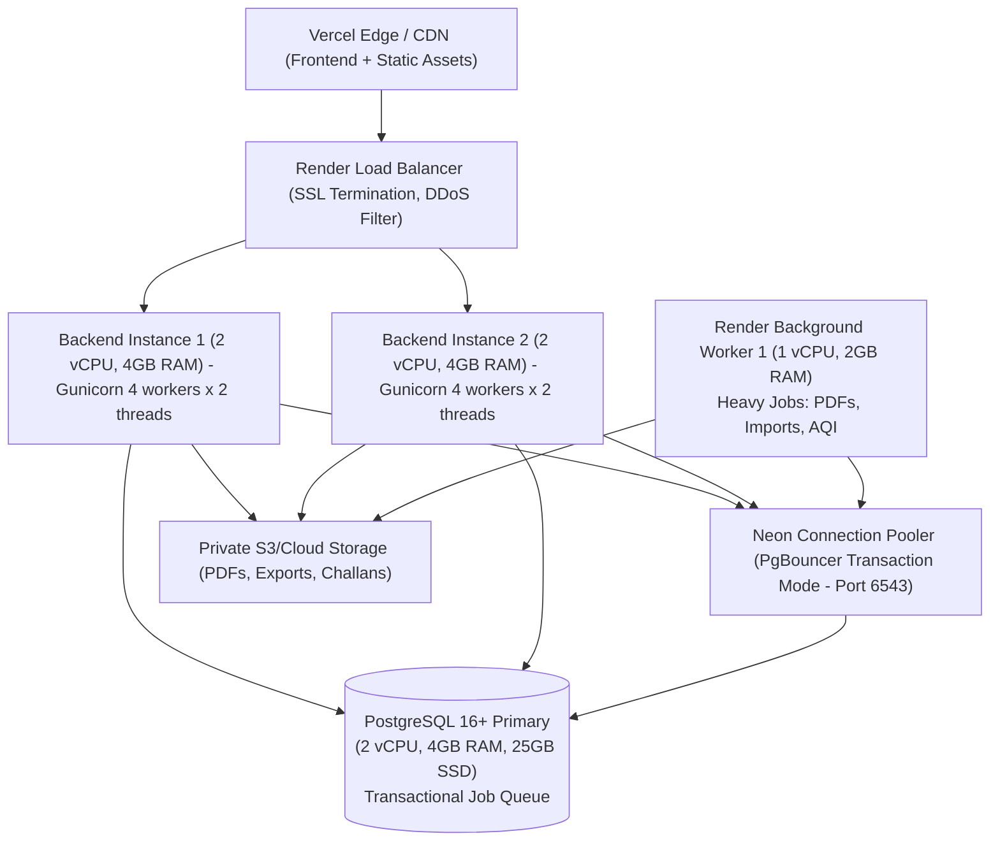

# OPTIMUS ORIEN — Capacity Model & Infrastructure Sizing Plan

**Version:** 1.0  
**Scope:** Multi-tenant SaaS (Pakistan / UK / International)  
**Baseline Institution Size:** 500 to 1,000 students per school campus  
**Horizons:**
- **Stage 1 (Pilot to Early Growth):** 1 to 10 schools (500 to 10,000 students)
- **Stage 2 (Expansion):** 11 to 50+ schools (10,000 to 50,000+ students)

---

## 1. Table Growth & Row Volume Estimates (Per School / Year)

### Assumptions
1. **Academic Year Duration:** 200 operational instructional days per academic year.
2. **Staff Headcount:** 40 to 60 teaching and administrative staff per 1,000 students (1:20 teacher-student ratio).
3. **Curriculum Load:** 8 subjects per student; 4 assessment terms per year; 3 assessment components (quizzes/assignments, midterm, final).
4. **Billing Cadence:** Monthly tuition vouchers (12 billing cycles) + 2 incidental charges per year.
5. **Communication Volume:** 1-2 broadcast announcements per week + automated absence/risk notifications.
6. **Data Retention:** Active academic records retained indefinitely; operational logs archived after 3 years.

| Domain / Big Table | Rows / Student / Year | Rows / School / Year (1,000 Students) | 10 Schools (Stage 1) | 50 Schools (Stage 2) | Avg Row Size | 1-Year DB Footprint (10 Schools) |
|---|---|---|---|---|---|---|
| **Attendance (`Attendance` + `StaffAttendance`)** | 200 student days + 12 staff days | **212,000** | 2.12M | 10.6M | ~120 bytes | ~254 MB |
| **Marks & Grades (`ExamStudentMark`, `Grade`, `CalculatedResult`)** | 96 marks + 32 calculated results | **128,000** | 1.28M | 6.4M | ~200 bytes | ~256 MB |
| **Fees & Invoicing (`StudentFee`, `FeePayment`, `Allocation`, `FinanceEntry`)** | 14 fees + 12 receipts + 20 allocations | **46,000** | 460,000 | 2.3M | ~350 bytes | ~161 MB |
| **Notifications (`Notification`, `ParentRiskAlert`, `Announcement`)** | ~100 notifications / student-guardian pair | **100,000** | 1.0M | 5.0M | ~250 bytes | ~250 MB |
| **Audit Logs (`AuditEvent`, `EvaluationAuditLog`)** | ~100 events / student | **100,000** | 1.0M | 5.0M | ~400 bytes | ~400 MB |
| **Behaviour & Observations (`WeeklyEvaluation`, `Observation`)** | 18 items × 36 weeks / 2 = 18 evals | **18,000** | 180,000 | 900,000 | ~300 bytes | ~54 MB |
| **Total Core Big Tables** | — | **~604,000 rows** | **~6.04M rows** | **~30.2M rows** | — | **~1.37 GB / yr (raw table data)** |

> [!NOTE]
> Including B-tree indexes (typically 60-80% of table size), WAL logs, and PostgreSQL page overhead, 10 schools consume approximately **3.0 to 4.5 GB of database storage per year**. At 50 schools, annual growth is approximately **15 to 22 GB per year**.

---

## 2. Peak Event Profiles & Concurrency Models

OPTIMUS ORIEN experiences four distinct operational burst events during a typical school calendar:

### Peak Event A: Morning Attendance Rush (07:45 – 08:30)
- **Profile:** Highly write-intensive, concentrated in a 20-minute window per school.
- **Participants:** 30 to 45 teachers per school simultaneously taking attendance for their homeroom or 1st period.
- **Traffic at 10 Schools:** 300 to 450 concurrent teachers submitting bulk rosters (25 to 40 students per payload).
- **Request Profile:** POST `/api/v1/attendance/mark/` with roster array.
- **Expected Concurrency:** ~40-60 req/sec peak.
- **Bottlenecks:** Row-level locking on `Attendance` table, audit log insertion per student, duplicate submission retries.

### Peak Event B: Monthly Fee Due Dates (1st – 10th of Month)
- **Profile:** Mixed read-write burst across parents and campus finance cashiers.
- **Participants:** 20-30% of parents checking vouchers online (`/api/v1/parent/fees/`), downloading PDF challans, and 2-3 finance operators entering bank scroll deposits (`/api/v1/fees/collect/`).
- **Traffic at 10 Schools:** 1,500 to 2,500 parents active per day. Peak evening hours (19:00 – 21:00) with ~200 concurrent sessions.
- **Expected Concurrency:** ~25-45 req/sec (read queries) + bursty PDF downloads.
- **Bottlenecks:** PDF generation compute, fee balance aggregation queries.

### Peak Event C: Term Result Publication (Examination Days)
- **Profile:** Extreme read spike immediately upon announcement SMS/notification dispatch.
- **Participants:** Up to 70% of parents and students accessing the portal within 90 minutes.
- **Traffic at 10 Schools:** 7,000 active students/parents. Concurrent active sessions: ~800 to 1,200.
- **Request Profile:** GET `/api/v1/student/results/`, GET `/api/v1/parent/overview/`, GET `/api/v1/dashboard/`.
- **Expected Concurrency:** **120 to 180 req/sec** sustained for 45 minutes.
- **Bottlenecks:** Complex joins across `ExamStudentMark`, `CalculatedStudentResult`, `GradeBand`, and `AQI` calculation engines. Without caching, database CPU saturates to 100%.

### Peak Event D: Bulk PDF Challan & Report Card Batch Generation
- **Profile:** CPU and memory-intensive batch tasks executed before terms or billing cycles.
- **Volume:** Generating 1,000 PDF report cards (2-4 pages each) or 1,000 3-copy fee challans per school.
- **Throughput:** 1 PDF report card ≈ 250ms CPU time; 1,000 PDFs = ~250 seconds of compute.
- **Requirement:** **Strictly forbidden on web request threads.** Must be offloaded to an asynchronous worker queue.

---

## 3. Infrastructure Sizing Proposal

### Stage 1: 1 to 10 Schools (Up to 10,000 Students)

#### Sizing Specifications (Stage 1)
- **Web API Instances:** 2 instances (for high availability and zero-downtime rolling deploys).
  - Compute: 2 vCPU, 4 GB RAM per instance.
  - Process Model: Gunicorn with `gthread` worker class: 4 worker processes × 2 threads = 8 concurrent connections per instance (16 total concurrent web workers).
- **Background Worker Instance:** 1 dedicated worker instance (1 vCPU, 2 GB RAM).
  - Dedicated process running `python manage.py run_jobs --concurrency=2` for asynchronous PDF generation, CSV imports, and batch notifications.
- **Database (PostgreSQL / Neon):**
  - Compute: 2 vCPU, 4 GB RAM.
  - Storage: 25 GB SSD with autoscaling up to 100 GB.
  - Connection Pooler: Neon pooled connection string (PgBouncer in transaction mode). `default_pool_size = 20`, max client connections = 100.
- **Cache:**
  - Redis / Valkey 256MB to 512MB (or Django database/locmem cache for zero-broker tier).
- **Object Storage:**
  - S3 / Render Private Disk: 50 GB for PDF challans, student photos, and exported xlsx backups.

---

### Stage 2: 11 to 50+ Schools (10,000 to 50,000+ Students)

#### Sizing Specifications (Stage 2)
- **Web API Instances:** 3 to 5 horizontally autoscaled instances.
  - Compute: 4 vCPU, 8 GB RAM per instance.
  - Gunicorn: 8 workers × 4 threads = 32 concurrent requests per node. Total cluster throughput: 120-160 concurrent requests (~600-800 req/sec with edge caching).
- **Background Worker Instances:** 2 dedicated worker instances (2 vCPU, 4 GB RAM each).
  - Partitioned queues: Worker A handles high-priority interactive jobs (single PDF generation, urgent SMS/WhatsApp). Worker B handles bulk batch tasks (term recalculations, 10,000 challan generation).
- **Database (PostgreSQL Primary + Read Replica):**
  - Primary (Write): 4 to 8 vCPU, 16 GB to 32 GB RAM, 200 GB NVMe SSD.
  - Read Replica (Optional for Result Days / BI): 4 vCPU, 16 GB RAM for analytical queries, parent portal dashboard queries, and audit log exports.
  - PgBouncer Pool: Centralized connection pooling handling 300+ client connections down to 40 PostgreSQL server backends.
- **Cache:**
  - Managed Redis (1 GB to 2 GB) with cluster replication for distributed dashboard invalidate-on-write caching and rate limiting counters.
- **Object Storage:**
  - 500 GB to 1 TB S3 with lifecycle transition to Glacier after 365 days.

---

## 4. Key Performance Indicators & SLA Targets

| Metric | Target SLA (p50) | Target SLA (p95) | Max Acceptable |
|---|---|---|---|
| **API Health Check (`/api/health`)** | < 10ms | < 25ms | 50ms |
| **Attendance Batch Submission (40 students)** | < 120ms | < 300ms | 600ms |
| **Parent Dashboard Overview** | < 80ms | < 200ms | 400ms |
| **Admin Consolidated Dashboard** | < 150ms | < 350ms | 800ms |
| **Marks Grid Read (50 students × 5 subjects)** | < 100ms | < 250ms | 500ms |
| **Fee Challan PDF Generation (Asynchronous)** | < 350ms | < 800ms | 2,000ms |
| **Error Rate (under peak load)** | < 0.05% | < 0.1% | 0.5% |
