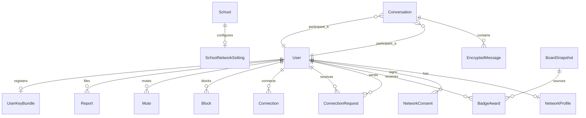

# Optimus Orien "Network" Feature: System Architecture, Data Model, API Specification & Execution Plan

**Document Path:** `design/network/plan.md`  
**Date:** November 2026  
**Status:** Stage 0 Complete — Implementation Ready  
**Scope:** Educational professional networking, verified academic leaderboards, connection management, child safety recognition boards, and end-to-end encrypted (E2EE) messaging for adult professionals.

---

## 1. Executive Summary & Core Principles

The **Network** area is a verified, internal academic professional network within Optimus Orien. It bridges educators, principals, and academic administrators across institutions while enforcing non-negotiable child protection boundaries, strict opt-in consent, and mathematical ranking derived exclusively from published school records.

### Non-Negotiable Core Rules
1. **Child Safety by Design**:
   - Users under 18 (and accounts with the `student` role) can **never** be contacted by, or contact, anyone through this feature.
   - Students have **no connection requests, no incoming requests, and no chat capability**.
   - The Student Achievers tab is an **honorary recognition board only**. No adult-to-child or cross-school child-to-child messaging channels exist.
   - The data model is future-proofed to allow school-moderated, same-school student collaboration in a later release, but zero messaging code is accessible to students in this version.
2. **Strict Opt-In & Instant Revocation**:
   - Zero passive listing: An educator or principal appears on a board only after explicitly agreeing to a versioned consent agreement in their account.
   - Instant Revocation: Consent withdrawal immediately purges the user from all boards, search queries, and public cache layers.
   - Dual-Gate for Staff: Staff appear on boards only if (1) their institution has enabled staff network boards (`SchoolNetworkSetting.staff_board_enabled = True`), and (2) the educator opted in.
   - Dual-Gate for Students: Students appear on the recognition board only if (1) their institution enabled student boards (`SchoolNetworkSetting.student_board_enabled = True`), and (2) a linked guardian provided explicit written/portal consent.
3. **Audience & Identity Verification**:
   - Accessible only to logged-in, authenticated adult accounts (`platform_admin`, `organisation_admin`, `principal`, `teacher`).
   - Parents and Students can only view their own school's Student Achievers tab.
   - Badges indicate trust level: `School-verified` (automatic via employment/enrollment) and `Platform-verified` (verified by platform administration).
4. **End-to-End Encrypted (E2EE) Professional Messaging**:
   - One-to-one messaging between mutually accepted adult connections only.
   - Cryptographic keys are generated inside the browser; private keys are never transmitted to or stored on the server.
   - The server stores only public keys, ciphertexts, nonces, and sender signatures.

---

## 2. Data Model & Database Architecture

The Network feature is inherently cross-school. All Network tables are **platform-level tables** without a `school_id` foreign key. They are reachable exclusively via the dedicated `/api/v1/network/` APIs and are completely inaccessible through tenant-scoped queries.

### Row-Level Security (RLS) & Tenant Boundary
- In PostgreSQL, platform-level tables are documented as intentionally unscoped.
- Conversations and Encrypted Messages are isolated strictly to the two authenticated participants via API query-level checks and a session-keyed PostgreSQL RLS policy:
  ```sql
  CREATE POLICY network_conversation_participant_policy ON core_networkconversation
  USING (
      participant_a_id = NULLIF(current_setting('app.current_user_id', true), '')::integer
      OR participant_b_id = NULLIF(current_setting('app.current_user_id', true), '')::integer
      OR current_setting('app.is_platform_admin', true) = 'true'
  );
  ```

### Entity Relationship Diagram


### Table Specifications

#### 1. `SchoolNetworkSetting`
Controls network visibility for an entire school.
- `school`: OneToOne to `School` (on_delete=CASCADE).
- `network_enabled`: Boolean (default `False`). Master switch for the campus.
- `staff_board_enabled`: Boolean (default `False`). Allows consenting staff to appear on boards.
- `student_board_enabled`: Boolean (default `False`). Allows consented students to appear on recognition boards.
- `updated_by`: FK to `User` (null=True).
- `updated_at`: DateTime.

#### 2. `NetworkProfile`
Professional presence for adult educators.
- `user`: OneToOne to `User` (on_delete=CASCADE).
- `headline`: CharField(max_length=140, blank=True). Short professional role.
- `bio`: TextField(max_length=1000, blank=True). Sanitized plain-text biography.
- `experience_years`: IntegerField(default=0). Self-declared years of teaching/leadership.
- `qualifications`: JSONField(default=list). Array of string qualifications (labeled self-declared).
- `subjects`: JSONField(default=list). Array of subject names taught.
- `interests`: JSONField(default=list). Array of collaboration tags (e.g. `["Mentoring", "STEM", "Curriculum"]`).
- `city_display`: CharField(max_length=100, blank=True).
- `country_display`: CharField(max_length=100, blank=True).
- `rank_display_mode`: CharField(choices=[`exact`, `tier_only`, `none`], default=`exact`).
- `allow_requests_from`: CharField(choices=[`anyone_verified`, `my_city_country`, `nobody`], default=`anyone_verified`).
- `show_school_name`: Boolean(default=True).
- `show_city`: Boolean(default=True).
- `show_online_status`: Boolean(default=False).
- `read_receipts_enabled`: Boolean(default=False).
- `is_platform_verified`: Boolean(default=False).
- `is_suspended`: Boolean(default=False). Administrative suspension.
- `created_at`: DateTime.
- `updated_at`: DateTime.

#### 3. `NetworkConsent`
Immutable audit log of user consent agreements.
- `user`: FK to `User` (on_delete=CASCADE).
- `consent_type`: CharField(choices=[`principal_board`, `teacher_board`, `student_recognition`, `e2ee_chat`]).
- `version`: CharField(max_length=20). E.g. `"2026.1"`.
- `granted`: Boolean(default=True).
- `granted_at`: DateTime.
- `withdrawn_at`: DateTime(null=True, blank=True).
- `ip_address`: GenericIPAddressField(null=True, blank=True).
- `user_agent`: TextField(blank=True).
- `guardian_user`: FK to `User` (null=True, blank=True). For student consents signed by parents.
- `written_consent_reference`: CharField(max_length=100, blank=True). School filing reference.

#### 4. `BoardSnapshot`
Immutable pre-computed board rankings from published exam periods.
- `board_type`: CharField(choices=[`principals`, `teachers`, `students`]).
- `period_identifier`: CharField(max_length=60). E.g. `"2025-2026 Term 2"`.
- `academic_year_name`: CharField(max_length=60).
- `subject_name`: CharField(max_length=100, blank=True, default=""). Required for teacher/student boards.
- `grade_level`: CharField(max_length=30, blank=True, default=""). Required for teacher/student boards.
- `entity_type`: CharField(choices=[`principal`, `teacher`, `student`]).
- `entity_id`: IntegerField(db_index=True). User ID (for principal/teacher) or Student ID (for student).
- `display_name`: CharField(max_length=150). Sanitized name or student alias.
- `school_name`: CharField(max_length=150).
- `campus_id`: IntegerField(null=True).
- `city`: CharField(max_length=100).
- `country`: CharField(max_length=100).
- `score`: DecimalField(max_digits=5, decimal_places=2). AQI or class examination average.
- `rank`: IntegerField(). Standard competition rank (1, 2, 2, 4).
- `tier_label`: CharField(max_length=50). E.g. `"Top 5%"`, `"Top 10%"`, `"Top 25%"`, `"Recognized Achiever"`.
- `positive_band`: CharField(max_length=50). E.g. `"Outstanding"`, `"Strong"`, `"Steady"`.
- `score_delta`: DecimalField(max_digits=5, decimal_places=2, null=True, blank=True). Difference vs previous period for "Most Improved".
- `is_most_improved`: Boolean(default=False).
- `student_count`: IntegerField(default=0). Context metadata.
- `assessment_count`: IntegerField(default=0). Context metadata.
- `is_eligible`: Boolean(default=True).
- `eligibility_reason`: CharField(max_length=200, blank=True).
- `config_version`: CharField(max_length=30). Calculation engine version.
- `generated_at`: DateTime.

#### 5. `BadgeAward`
Audited accolades tied to snapshots and verified statuses.
- `user`: FK to `User` (on_delete=CASCADE, null=True, blank=True). For educators.
- `student`: FK to `Student` (on_delete=CASCADE, null=True, blank=True). For student achievers.
- `badge_type`: CharField(choices=[`gold`, `silver`, `bronze`, `most_improved`, `consistent_performer`, `school_verified`, `platform_verified`]).
- `title`: CharField(max_length=100). E.g. `"Gold Award - Grade 9 Mathematics"`.
- `period_identifier`: CharField(max_length=60, blank=True).
- `source_snapshot`: FK to `BoardSnapshot` (null=True, blank=True, on_delete=SET_NULL).
- `awarded_at`: DateTime.
- `revoked`: Boolean(default=False).
- `revoked_at`: DateTime(null=True, blank=True).
- `audit_note`: CharField(max_length=255, blank=True).

#### 6. `ConnectionRequest`
Pending connection invitations.
- `from_user`: FK to `User` (related_name=`sent_connection_requests`, on_delete=CASCADE).
- `to_user`: FK to `User` (related_name=`received_connection_requests`, on_delete=CASCADE).
- `note`: CharField(max_length=200, blank=True). Plain text introduction.
- `status`: CharField(choices=[`pending`, `accepted`, `declined`, `withdrawn`], default=`pending`).
- `created_at`: DateTime.
- `responded_at`: DateTime(null=True, blank=True).
- Constraints: Unique constraint on `(from_user, to_user)` where status is `pending`.

#### 7. `Connection`
Active two-way relationships.
- `user_a`: FK to `User` (on_delete=CASCADE, related_name=`connections_a`).
- `user_b`: FK to `User` (on_delete=CASCADE, related_name=`connections_b`).
- `status`: CharField(choices=[`active`, `removed`], default=`active`).
- `created_at`: DateTime.
- `removed_at`: DateTime(null=True, blank=True).
- Constraints: Check constraint `user_a_id < user_b_id` for deterministic pairing; UniqueConstraint on `(user_a, user_b)`.

#### 8. `Block` & `Mute`
- **`Block`**: `blocker` (FK User), `blocked` (FK User), `reason` (CharField), `created_at`. Prevents requests, stops delivery, hides profiles.
- **`Mute`**: `muter` (FK User), `muted` (FK User), `created_at`. Silences notifications without terminating the connection.

#### 9. `Report`
Misconduct reports for platform administrators.
- `reporter`: FK to `User` (on_delete=CASCADE).
- `reported_user`: FK to `User` (on_delete=CASCADE).
- `category`: CharField(choices=[`harassment`, `spam`, `inappropriate_content`, `impersonation`, `other`]).
- `details`: TextField(max_length=1000). Plain text explanation.
- `decrypted_evidence`: JSONField(default=list, blank=True). Optional array of client-decrypted, sender-signed message envelopes submitted by the reporter.
- `status`: CharField(choices=[`pending`, `in_review`, `resolved_action_taken`, `dismissed`], default=`pending`).
- `moderator_notes`: TextField(blank=True).
- `resolved_by`: FK to `User` (null=True, blank=True).
- `resolved_at`: DateTime(null=True, blank=True).
- `created_at`: DateTime.

#### 10. `UserKeyBundle`
Public cryptographic identity keys for E2EE (Stage 3/4).
- `user`: OneToOne to `User` (on_delete=CASCADE).
- `identity_key`: TextField(). Base64 public identity key.
- `signed_prekey`: TextField(). Base64 public signed prekey.
- `prekey_signature`: TextField(). Base64 signature of the prekey.
- `one_time_keys`: JSONField(default=list). Array of base64 one-time public prekeys.
- `device_id`: CharField(max_length=64, default="primary").
- `updated_at`: DateTime.

#### 11. `Conversation` & `EncryptedMessage`
One-to-one encrypted channels.
- **`Conversation`**: `participant_a` (FK User), `participant_b` (FK User, `participant_a_id < participant_b_id`), `status` (`active`, `blocked`, `closed`), `created_at`, `last_activity_at`.
- **`EncryptedMessage`**: `conversation` (FK Conversation), `sender` (FK User), `ciphertext` (TextField), `nonce` (CharField, max_length=128), `sender_signature` (TextField), `size_bytes` (IntegerField), `sent_at` (DateTime), `delivered_at` (DateTime, null=True).

#### 12. `NetworkAuditEvent`
Compliance trail for security and safety events.
- `event_type`: CharField(max_length=50). (e.g. `consent_granted`, `consent_withdrawn`, `connection_blocked`, `report_filed`, `keys_updated`).
- `actor`: FK to `User` (null=True, on_delete=SET_NULL).
- `target_type`: CharField(max_length=50).
- `target_id`: IntegerField(null=True).
- `metadata`: JSONField(default=dict). Plain data only — never secrets or plaintext.
- `ip_address`: GenericIPAddressField(null=True).
- `created_at`: DateTime.

---

## 3. API Contracts & Endpoint Specification

All endpoints reside under `/api/v1/network/`. Authentication is strictly required (Bearer / Session).

### A. Profiles & Privacy Settings
- `GET /api/v1/network/profile/me/`: Returns authenticated user's profile and privacy configuration.
- `PATCH /api/v1/network/profile/me/`: Updates headline, bio, experience, subjects, interests, display settings.
- `GET /api/v1/network/profiles/<int:user_id>/`: Retrieves a peer's profile.
  - Enforces privacy filters (`allow_requests_from`, blocked checks, `show_school_name`).
  - Returns badges, verified status, and mutual connection status.
  - Returns `404` for non-consented or blocked users.

### B. Consent & Preferences
- `GET /api/v1/network/consent/`: Returns active consent states for the user.
- `POST /api/v1/network/consent/`: Grants explicit consent for a board or chat feature.
  - Payload: `{"consent_type": "teacher_board", "version": "2026.1"}`.
- `POST /api/v1/network/consent/withdraw/`: Instantly revokes consent.
  - Triggers immediate removal from `BoardSnapshot` and caches.

### C. Ranked Boards & Leaderboards
- `GET /api/v1/network/boards/principals/`: Ranked principals.
  - Query params: `period`, `country`, `city`, `board`, `page`, `page_size`.
  - Response: Paginated list with podium (ranks 1-3), score, band label, sparkline data, badges.
- `GET /api/v1/network/boards/teachers/`: Ranked teachers within subject and grade.
  - Query params: `subject` (required), `grade_level` (required), `period`, `city`, `board_type`, `most_improved` (bool), `page`.
  - Response: Paginated list, teacher chosen display mode (`exact`, `tier`, or `unranked`), contextual assessment and student count.
- `GET /api/v1/network/boards/students/`: Student Achievers recognition board.
  - Query params: `grade_level` (required), `subject` (required), `period`, `page`.
  - Response: Display alias (e.g. "Ahmed K."), grade, subject, positive distinction ("Top Achiever in Mathematics"), school name (if consented).
  - **No contact button, no profile link, no message path.**
- `GET /api/v1/network/boards/meta/`: Returns available subjects, grade levels, and assessment periods for filter dropdowns.

### D. Connection Requests & Network Graph
- `POST /api/v1/network/requests/`: Send connection request.
  - Payload: `{"to_user_id": 42, "note": "Hello, interested in your STEM curriculum!"}` (note max 200 chars).
  - Validation:
    - Minors (students) immediately rejected with `403 Forbidden`.
    - Daily limit: Max 20 requests per day per user.
    - Check target user privacy (`nobody` or `my_city_country`).
    - Cooldown check: 7-day cooldown after target declines.
- `GET /api/v1/network/requests/received/`: Pending requests received.
- `GET /api/v1/network/requests/sent/`: Pending requests sent.
- `POST /api/v1/network/requests/<int:id>/accept/`: Accepts request, establishes `Connection`.
- `POST /api/v1/network/requests/<int:id>/decline/`: Declines request, initiates cooldown.
- `POST /api/v1/network/requests/<int:id>/withdraw/`: Sender withdraws request.
- `GET /api/v1/network/connections/`: List of active accepted connections.
- `DELETE /api/v1/network/connections/<int:peer_id>/`: Disconnects peer.
- `GET /api/v1/network/connections/suggested/`: Heuristic recommendations (same subject, same city, mutual connections).

### E. Safety, Blocking & Moderation
- `POST /api/v1/network/block/`: Block a user (`{"user_id": 42, "reason": "spam"}`).
- `DELETE /api/v1/network/block/<int:user_id>/`: Unblock user.
- `POST /api/v1/network/mute/`: Mute notifications from user.
- `DELETE /api/v1/network/mute/<int:user_id>/`: Unmute user.
- `POST /api/v1/network/report/`: File misconduct report.
  - Payload: `{"reported_user_id": 42, "category": "harassment", "details": "...", "decrypted_evidence": [...]}`.
- `GET /api/v1/network/admin/moderation/`: Platform admin moderation queue.
- `POST /api/v1/network/admin/moderation/<int:report_id>/resolve/`: Action report (dismiss, warn, suspend user from Network).

---

## 4. Ranking Methodology & Snapshot Generation

### Snapshot Engine (`core.services.network_ranking`)
Rankings are generated via the management command:
```bash
python manage.py refresh_network_snapshots [--period "2025-2026 Term 2"]
```
All ranks are computed offline from published assessments and stored immutably. **Live board endpoints never query raw assessment tables.**

### Mathematical Ranking Rules
1. **Competition Ranking (Standard 1, 2, 2, 4)**:
   - When entities share identical scores, they receive the identical rank.
   - The subsequent rank increments by the count of tied predecessors.
2. **Principals Board**:
   - Ranked by Campus Academic Quality Index (AQI), reusing verified AQI snapshot calculations.
   - Minimum campus eligibility: $\ge 15$ students, $\ge 2$ published examinations across $\ge 3$ subjects.
3. **Teachers Board**:
   - Scope: **Strictly within a Subject and Grade Level**. A teacher is never pitted against an educator of a different discipline.
   - Metric: Mean score of published curriculum assessments for that teacher's classes during the period.
   - Minimum eligibility: $\ge 15$ students taught, $\ge 2$ published assessments.
   - "Most Improved": Ranked by $\Delta = \text{Score}_{\text{current}} - \text{Score}_{\text{previous}}$. Requires an eligible prior snapshot.
4. **Student Achievers Board**:
   - Scope: Within Subject and Grade Level.
   - Displays students in the top percentiles of published subject assessments.
   - Displays positive honors only. Never displays low scores or rankings outside distinction thresholds.

### Honesty Statement & Disclaimer
Displayed prominently on all board headers:
> *"Rankings and recognition awards are computed strictly from internal examination results published by participating Optimus Orien institutions. Curricula, grading standards, and student bodies vary across campuses. These boards recognize academic achievement within our network and do not constitute external accreditation or an official regulatory inspection."*

---

## 5. Badges & Accolades System

| Badge | Criteria | Scope | Target Roles |
| :--- | :--- | :--- | :--- |
| **Gold** | Rank 1 in verified period snapshot | Subject & Level / AQI | Principal, Teacher, Student |
| **Silver** | Rank 2 in verified period snapshot | Subject & Level / AQI | Principal, Teacher, Student |
| **Bronze** | Rank 3 in verified period snapshot | Subject & Level / AQI | Principal, Teacher, Student |
| **Most Improved** | Highest positive delta $\Delta$ vs prior period | Subject & Level / AQI | Principal, Teacher |
| **Consistent Performer** | Top 25% for 3+ consecutive periods | Subject & Level / AQI | Principal, Teacher |
| **School-verified** | Confirmed faculty / staff enrollment | Institutional | Principal, Teacher |
| **Platform-verified** | Verified by Optimus Orien platform leadership | Manual Audit | Principal, School Owner |

If a gradebook correction triggers a snapshot recalculation, the badge recalculation engine revokes outdated awards and audits new awards automatically.

---

## 6. End-to-End Encrypted (E2EE) Chat Architecture

*(Detailed cryptographic design will be delivered in Stage 3: `design/network/e2ee-design.md`)*

### High-Level Architecture
1. **Browser Key Generation**: Each adult user's browser generates a public-private identity key pair using modern Web Crypto APIs.
2. **Server Zero-Knowledge**: The server stores only public keys. The private key remains in the browser's indexed storage or wrapped with a user-passphrase-derived key.
3. **Session Transport**: Short polling while conversation pane is open (or Server-Sent Events). Zero external broker (Redis/Channels) required for standard hosting.
4. **Safety Verification**: Contacts can compare Safety Numbers (fingerprints derived from their identity keys) or scan a QR code to detect man-in-the-middle tampering.
5. **Report with Evidence**: When a user reports abusive chat, their client app decrypts the conversation history and submits the sender's cryptographically signed ciphertext envelopes for moderator review.

---

## 7. Permission Matrix per Role

| Capability | Platform Admin | Org Admin / Owner | Principal | Teacher | Student (Child) | Parent |
| :--- | :---: | :---: | :---: | :---: | :---: | :---: |
| **View Principals Board** | Yes | Yes | Yes | Yes | No | No |
| **View Teachers Board** | Yes | Yes | Yes | Yes | No | No |
| **View Student Achievers** | Yes (All) | Yes (Own Org) | Yes (Own School) | Yes (Own School) | Yes (Own School) | Yes (Own School) |
| **Manage School Network Settings**| Yes | Yes | Yes | No | No | No |
| **Grant Board Consent** | N/A | Yes | Yes | Yes | No | Yes (Guardian) |
| **Create Network Profile** | Yes | Yes | Yes | Yes | **BLOCKED** | **BLOCKED** |
| **Send Connection Request** | Yes | Yes | Yes | Yes | **BLOCKED** | **BLOCKED** |
| **Receive Connection Request** | Yes | Yes | Yes | Yes | **BLOCKED** | **BLOCKED** |
| **E2EE Chat** | Yes | Yes | Yes | Yes | **BLOCKED** | **BLOCKED** |
| **Block / Mute / Report** | Yes | Yes | Yes | Yes | No | No |
| **Moderate Network Queue** | Yes | No | No | No | No | No |

---

## 8. Threat Model (STRIDE)

| Threat Category | Potential Attack Vector | Countermeasure & Security Control |
| :--- | :--- | :--- |
| **Spoofing** | Attacker creates fake principal/teacher account or poses as child | Accounts are created strictly through school tenant rosters; verification badges are tied to institutional records. |
| **Tampering** | User manipulates board ranking or assessment scores | Ranks are served from immutable `BoardSnapshot` generated from published grades via the server-side calculation engine. |
| **Repudiation** | User denies sending harassment in connection note or report | Connection notes are audit-logged with user ID and timestamp; reported messages contain the sender's cryptographic signature. |
| **Information Disclosure** | Scraping of student data or unconsented staff emails | Zero student PII on boards (alias only); contact info is never rendered in HTML; search returns generic "No results" for non-consented users. |
| **Denial of Service** | Connection request spamming, bot scraping, chat bombing | Rate limiting (max 20 requests/day, cooldown after decline); honeypot fields on forms; strict request size limits. |
| **Elevation of Privilege** | Student or parent attempts to send connection request or chat | Server-side role and age validation on **every single endpoint** (rejects `student` and `parent` roles with `403 Forbidden`). |

---

## 9. Screen Flow & UI/UX Navigation (Mode A)

- **Sidebar Entry**: `"Network"` (Urdu: `"نیٹ ورک"`).
- **Sub-Views**:
  1. **Boards View (`/app/network/boards`)**:
     - Tabs: `Principals`, `Teachers`, `Student Achievers`.
     - Visual Podium for Top 3 (1st: Gold, 2nd: Silver, 3rd: Bronze).
     - Filter Bar (Country, City, Subject, Grade Level, Period).
     - Metric Context: Assessment count, student group size, positive tier label.
  2. **Requests View (`/app/network/requests`)**:
     - Sub-tabs: `Received` (with Accept/Decline) and `Sent` (with Withdraw).
     - Character-limited connection note preview.
  3. **Connections View (`/app/network/connections`)**:
     - Searchable grid of connected colleagues with Quick Message and Disconnect options.
     - "Suggested Colleagues" carousel (same subjects or location).
  4. **Chat Pane (`/app/network/messages`)**:
     - Mobile-first single pane, desktop split layout.
     - E2EE Shield lock indicator.
     - Safety Number verification modal.
     - User-initiated "Report Conversation" action.
  5. **My Profile & Privacy (`/app/network/profile`)**:
     - Live card preview, headline, bio editor, subjects and interests chips.
     - Privacy controls: Display mode (`Exact`, `Tier`, `None`), Request eligibility, Consent toggle.
  6. **Safety & Ethics Center (`/app/network/safety`)**:
     - Explanatory guidance in English and Urdu on data protection, child safety rules, and reporting.

---

## 10. Implementation Effort Estimation

| Stage | Description | Best Case (Days) | Likely Case (Days) | Worst Case (Days) |
| :--- | :--- | :---: | :---: | :---: |
| **Stage 0** | Comprehensive plan, architecture, threat model, inspiration board | 0.5 | 0.5 | 1.0 |
| **Stage 1** | Backend models, migrations, snapshots, permissions, safety tools, tests | 2.0 | 3.0 | 4.0 |
| **Stage 2** | UI for boards, podium, profiles, requests, connections, responsive/RTL | 2.0 | 3.0 | 4.5 |
| **Stage 3** | E2EE Cryptographic Design document & evaluation | 1.0 | 1.5 | 2.0 |
| **Stage 4** | E2EE chat implementation, Playwright e2e tests, screenshots, traceability | 2.5 | 3.5 | 5.0 |
| **Total** | Full Implementation Lifecycle | **8.0 Days** | **11.5 Days** | **16.5 Days** |

---

## 11. Key Alignment Questions & Architectural Decisions

The following architectural questions are surfaced for stakeholder confirmation:

1. **Parents in the Network**:
   - *Current Decision:* Parents are barred from adult professional networking (no connect, no chat) and can only view their school's Student Achievers board.
   - *Question:* Should verified PTA / School Parent Council leaders be granted a special networking tier in a future phase, or remain strictly excluded?
2. **Feature Entitlements & Subscription Tiers**:
   - *Current Decision:* Viewing boards that require AQI or teacher analytics requires a Premium school subscription. Basic profiles, connection requests, and 1-to-1 messaging are available to all authenticated adult users.
   - *Question:* Does this match platform monetization requirements?
3. **Teacher Ranking Metrics**:
   - *Current Decision:* Rankings are strictly within a subject and grade level, using published assessment averages and a separate "Most Improved" board.
   - *Question:* Should attendance consistency or curriculum completion percentage be factored into teacher rankings in later phases, or remain purely based on assessment outcomes?
4. **Platform Verification Workflow**:
   - *Current Decision:* Platform verification is reserved for school owners and principals, granted manually by platform administrators.
   - *Question:* Should distinguished teachers with multiple Gold awards also be eligible for platform verification?
5. **Message Retention Policy**:
   - *Current Decision:* Encrypted ciphertexts are retained for 90 days on the server by default (configurable), after which expired messages are purged from server storage.
   - *Question:* Is a 90-day retention window acceptable for the institution?
6. **Legal & Ethical Review**:
   - Consent texts and child safety mechanisms must be reviewed by qualified educational legal counsel prior to commercial rollout.
