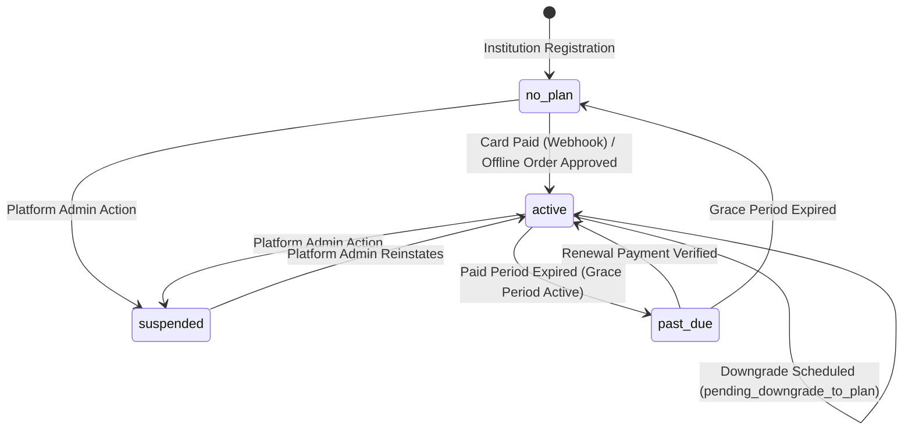

# Subscription Plans, Entitlements Engine, and Feature Locking Architecture

**Author:** Optimus Orien Architecture Team  
**Date:** November 2026  
**Document Version:** 2.0 (Updated: No Free Trial, 3 Access Levels, 1/4/8/12 Mo Billing Periods, Upgrade Credit, Plain Language Receipt)  
**Target System:** Optimus Orien SaaS (`backend` / `frontend` / `spec`)  
**Status:** Approved for Implementation (Stage 1: Design, Backend & Tests Completed)

---

## 1. Executive Summary & Core Business Decisions

Optimus Orien introduces a high-integrity, multi-tenant subscription tiers and feature-entitlement system designed to support both hosted card payments (Paddle Billing / card sandbox) and offline bank deposits, backed by server-side feature access control and PostgreSQL Row Level Security (RLS).

### 1.1 Commercial & Operational Principles

1. **No Free Trial:**
   - Free trials are completely eliminated: no trial models, no trial countdown banners, no trial trial seeds, and no trial text on pricing/registration surfaces.
   - Newly registered schools start in status `no_plan` (nothing paid yet).
   - Premium features AND paid Standard features are locked on `no_plan`.
   - A `no_plan` school keeps only a small basic access list, stored as data (`PlatformBillingSettings.basic_access_features`):
     - `school_setup`
     - `people_accounts`
     - `authentication` / security essentials (login, password change, profile view)
     - `subscription_management` (viewing own plan and billing page, submitting payment orders)
     - `support_contact`
     - `compliance_export` & `basic_reports_csv`
     - `english_urdu`
   - Existing demo schools created by seed commands retain an active Premium subscription so live demos are not blocked.

2. **Access Levels & Tier Architecture:**
   - **`no_plan`**: Basic access list only. All academic, financial, attendance, and intelligence modules are locked with HTTP 403 `feature_locked`.
   - **`standard`**: $3.60 USD / student / month (Seed PKR: Rs 1,000 / student / month, approximate). Unlocks Standard academic, fee, and portal features. Premium features remain locked with HTTP 403 `feature_locked` (`required_plan: 'premium'`).
   - **`premium`**: $7.20 USD / student / month (Seed PKR: Rs 2,000 / student / month, approximate). Unlocks all features across the platform.
   - **`custom` (Custom Package Modular Builder)**: Tailored plan for schools requiring granular module selection and flexible student headcounts. Base platform fee of $2.00 USD / Rs 550 PKR per student/mo + modular add-on rates ($0.20 for standard features, $0.40 for premium features). Grants granular `SchoolFeatureOverride` records matching the exact chosen modules.
   - All prices, feature lists, and marketing copy are dynamic DATA in the database (`Plan`, `PlanFeature`, `FeatureCatalog`), never hardcoded in application logic.

3. **Billing Periods & Tiered Discounts (Standard, Premium & Custom):**
   - Configurable billing periods: **1, 4, 8, 12, 24, 36, and 60 months** (stored as data in `BillingPeriod` model, editable by platform admin).
   - Term discounts:
     - 1 month: **0.00%** discount
     - 4 months: **5.00%** discount
     - 8 months: **10.00%** discount
     - 12 months (1 year): **15.00%** discount
     - 24 months (2 years): **20.00%** discount
     - 36 months (3 years): **25.00%** discount
     - 60 months (5 years): **30.00%** discount
   - Formula:
     $$\text{Subtotal} = \text{Active Students} \times \text{Unit Price} \times \text{Months}$$
     $$\text{Discount Amount} = \text{Subtotal} \times \left(\frac{\text{Discount Percentage}}{100}\right)$$
     $$\text{Net Total} = \text{Subtotal} - \text{Discount Amount} - \text{Upgrade Credit}$$
   - Worked Examples (100 students):
     - **Standard ($3.60/student/mo):**
       - 1 month: $360.00
       - 4 months: $1,440.00 - 5% ($72.00) = $1,368.00
       - 8 months: $2,880.00 - 10% ($288.00) = $2,592.00
       - 12 months: $4,320.00 - 15% ($648.00) = $3,672.00
     - **Premium ($7.20/student/mo):**
       - 1 month: $720.00
       - 4 months: $2,880.00 - 5% ($144.00) = $2,736.00
       - 8 months: $5,760.00 - 10% ($576.00) = $5,184.00
       - 12 months: $8,640.00 - 15% ($1,296.00) = $7,344.00
   - All financial figures are rounded strictly to 2 decimal places using Python `Decimal`.

4. **Upgrades, Downgrades & Transitions:**
   - **Standard $\rightarrow$ Premium during an active period:** Unused value of the current period is credited against the new Premium order:
     $$\text{Daily Rate} = \frac{\text{Current Monthly Cost}}{30}$$
     $$\text{Upgrade Credit} = \text{Remaining Days} \times \text{Daily Rate}$$
     The upgrade credit is explicitly displayed as its own line on the invoice and receipt.
   - **Premium $\rightarrow$ Standard Downgrade:** Takes effect at the end of the paid billing period (`pending_downgrade_to_plan`). Full Premium access is preserved until `paid_until`. No tenant data is ever deleted.
   - **Unrenewed Expiry:** When a paid term ends without renewal, the school transitions to `past_due` with a configurable grace period (default 7 days) with full access maintained. If grace expires, status transitions to `no_plan`. Data created in Premium features remains stored in PostgreSQL and is restored immediately on re-upgrade.

5. **Plain-Language Receipt / Invoice:**
   Every invoice/receipt exposes 13 plain-language items with bilingual English/Urdu student headcount explanatory text:
   - Receipt Number (`REC-ORD-...`) & Date
   - School Name & Code
   - Payment Reference
   - Payment Method: Card brand + last 4 digits only (e.g. `Visa ending in 4242`)
   - Plan Name & Code
   - Billing Period: Start date to end date
   - Students Counted with explanatory help text:
     - EN: *"You are charged per active student, so this number is multiplied by the monthly price."*
     - UR: *"آپ سے فی فعال طالب علم چارج کیا جاتا ہے، اس لیے اس تعداد کو ماہانہ قیمت سے ضرب دیا جاتا ہے۔"*
   - Unit price per student per month
   - Billing months (1, 4, 8, 12)
   - Subtotal (Students $\times$ Unit Price $\times$ Months)
   - Discount (% and amount saved)
   - Upgrade credit (unused value credited from previous plan)
   - Tax amount (0.00 / MoR handles)
   - Total paid & Currency (USD / PKR)
   - Student growth beyond invoice: Flagged and tracked for next renewal billing; never blocks current access.

---

## 2. Feature Key Catalog & Entitlements Matrix

| Feature Key | Display Name (EN / UR) | Tier | Category | Protected Backend Endpoints |
| :--- | :--- | :--- | :--- | :--- |
| `school_setup` | School Setup & Profile اسکول سیٹ اپ | Basic (`no_plan`) | `core` | `/api/v1/onboarding/*`, `/api/v1/schools/settings/` |
| `people_accounts` | Student & Staff Directory طلباء اور عملہ کے اکاؤنٹس | Basic (`no_plan`) | `core` | `/api/v1/students/*`, `/api/v1/staff/*` |
| `subscription_management`| Plan & Billing Console سبسکرپشن اور بلنگ | Basic (`no_plan`) | `core` | `/api/v1/subscription/*` |
| `compliance_export` | Regulatory Data Export ڈیٹا ایکسپورٹ | Basic (`no_plan`) | `operations`| `/api/v1/exports/students.csv` |
| `basic_reports_csv` | Basic CSV Data Reports سی ایس وی رپورٹس | Basic (`no_plan`) | `operations`| `/api/v1/reports/export/csv/*` |
| `english_urdu` | Full Bilingual Support اردو اور انگریزی سپورٹ | Basic (`no_plan`) | `core` | Global UI Localization |
| `attendance_daily` | Daily Attendance Tracking روزانہ حاضری | Standard | `academics` | `/api/v1/attendance/*` |
| `marks_grading` | Marks Entry & Grading Criteria نمبرات اور گریڈنگ | Standard | `academics` | `/api/v1/grading/*`, `/api/v1/assessments/*` |
| `exams_datesheets` | Exam Timetables & Schedules امتحانی ڈیٹ شیٹ | Standard | `academics` | `/api/v1/exams/*` |
| `result_cards` | Result Cards & Term Slips نتائج کے کارڈز | Standard | `academics` | `/api/v1/exam-engine/results/*` |
| `timetable` | Class Timetable Scheduling ٹائم ٹیبل | Standard | `academics` | `/api/v1/timetable/*` |
| `fees_offline` | Offline Fee Challans & Collection فیس چالان اور وصولی | Standard | `finance` | `/api/v1/fees/*`, `/api/v1/fees/defaulters/*` |
| `tasks_homework` | Tasks & Homework Assignments ہوم ورک اور اسائنمنٹس | Standard | `academics` | `/api/v1/homework/*` |
| `notices` | Circulars & School Announcements اعلانات اور نوٹسز | Standard | `operations`| `/api/v1/announcements/*` |
| `portals_basic` | Basic Portals (Teacher, Student, Parent)| Standard | `core` | `/api/v1/teacher/*`, `/api/v1/student/*`, `/api/v1/parent/*` |
| `class_subject_performance`| Class & Subject Performance کلاس اور مضمون کی کارکردگی | Standard | `analytics` | `/api/v1/analytics/class-subject/` |
| `trends_basic` | Current & Previous Term Trends بنیادی تعلیمی رجحانات | Standard | `analytics` | `/api/v1/analytics/trends/` |
| `aqi` | Academic Quality Index (AQI) تعلیمی معیار کا اشاریہ | Premium | `analytics` | `/api/v1/aqi/calculate/`, `/api/v1/aqi/dashboard/` |
| `aqi_history` | Longitudinal AQI Historical Trends تاریخی اے کیو آئی رجحانات | Premium | `analytics` | `/api/v1/aqi/history/*` |
| `early_intervention` | Early Intervention & Risk Cases ابتدائی مداخلت کے کیسز | Premium | `analytics` | `/api/v1/interventions/*`, `/api/v1/risk/` |
| `attention_indicators` | Attention & Behavioral Risk Flags توجہ اور خطرے کے اشاریے | Premium | `analytics` | `/api/v1/risk/indicators/*` |
| `automated_alerts` | Automated Academic & Attendance Alerts خودکار تعلیمی انتباہات | Premium | `operations`| `/api/v1/alerts/*` |
| `multi_campus` | Multi-Campus Operations کثیر کیمپس انتظام | Premium | `core` | `/api/v1/campuses/network/*` |
| `campus_comparison` | Cross-Campus Benchmarking کیمپسز کا تقابلی جائزہ | Premium | `analytics` | `/api/v1/analytics/campus-comparison/*` |
| `accounts_ledger` | Double-Entry Financial Ledger کھاتہ جات اور لیجر | Premium | `finance` | `/api/v1/finance/ledger/*` |
| `finance_dashboard` | Executive Finance Dashboard مالیاتی ڈیش بورڈ | Premium | `finance` | `/api/v1/finance/dashboard/*` |
| `hr_payroll` | HR, Staff Salaries & Payroll Engine عملہ کی تنخواہیں اور پے رول | Premium | `finance` | `/api/v1/payroll/*`, `/api/v1/salaries/*` |
| `psych_eval` | Psychological Evaluation Module نفسیاتی مشاہداتی نظام | Premium | `safeguarding`| `/api/v1/psychological-evaluations/*` |
| `audit_log_viewer` | System Audit Log Viewer & Exporter آڈٹ لاگ معائنہ کار | Premium | `operations`| `/api/v1/audit/` |

---

## 3. Subscription State Machine

### 3.1 Status Specifications & Entitlements

| Status Code | Description | Unlocked Features | Write Access | End-User UI Experience |
| :--- | :--- | :--- | :--- | :--- |
| `no_plan` | School registered; no plan paid yet. | Basic access features only. | Allowed on basic features. Paid features locked. | Feature lock screen on paid modules: *"Unlock with Standard or Premium"*. |
| `active` | Active paid subscription in good standing. | Plan tier features (`standard` or `premium`). | Full read/write for plan features. | Plan badge in header: *"Standard Plan"* or *"Premium Plan"*. |
| `past_due` | Paid period ended; school in grace period (default 7 days). | Full prior plan features maintained. | Full read/write during grace. | High-visibility warning banner: *"Subscription expired on YYYY-MM-DD. Grace period active for X days."* |
| `suspended` | Administrative lockdown by platform owner. | Zero feature access. | Blocked. | Full-screen suspension notice. |

---

## 4. API Endpoints

### 4.1 Public Endpoints
- `GET /api/v1/public/pricing/`: Plans (USD/PKR), active billing periods with discounts, catalog features.
- `GET /api/v1/public/billing-info/`: Billing periods, grace periods, basic access features.
- `POST /api/v1/subscription/webhook/`: Signature-verified payment provider webhook receiver.

### 4.2 School Tenant Billing Endpoints
- `GET /api/v1/subscription/current/`: Current subscription status, plan, dates, student counts.
- `GET /api/v1/subscription/entitlements/`: Server-side feature access evaluation and lock flags.
- `GET /api/v1/subscription/invoice-estimate/?plan=premium&months=4`: Real-time invoice estimate with period discount and upgrade credit.
- `POST /api/v1/subscription/orders/`: Creates card checkout session or submits offline bank payment proof.
- `GET /api/v1/subscription/orders/`: Historical payment orders for this school.
- `GET /api/v1/subscription/orders/<id>/receipt/`: Plain-language receipt with 13 items and bilingual student count help text.
- `POST /api/v1/subscription/downgrade/`: Schedules Premium to Standard downgrade at period end.
- `GET /api/v1/subscription/bank-details/`: Bank credentials for offline payment transfers.

### 4.3 Platform Admin Console Endpoints
- `GET/PUT /api/v1/platform-admin/billing/settings/`: Manages basic access features, grace days, and bank details.
- `GET/POST /api/v1/platform-admin/billing/periods/`: Manages billing periods (1, 4, 8, 12 months) and discount tiers.
- `GET/PUT /api/v1/platform-admin/billing/plans/`: Manages plans and USD / PKR prices.
- `GET /api/v1/platform-admin/billing/schools/`: School subscription directory and health metrics.
- `GET /api/v1/platform-admin/billing/orders/`: Operational queue of offline orders.
- `POST /api/v1/platform-admin/billing/orders/<id>/approve/`: Approves payment and activates subscription.
- `POST /api/v1/platform-admin/billing/orders/<id>/reject/`: Rejects payment with audit note.
- `POST /api/v1/platform-admin/billing/schools/<id>/feature-override/`: Custom feature overrides.

---

## 5. Effort Estimation in Working Days

| Stage | Scope | Deliverables | Working Days |
| :--- | :--- | :--- | :--- |
| **Stage 1 (Completed)** | Architecture, Models, Backend Engine & Tests | - Models: `BillingPeriod`, `PlatformBillingSettings`, `SchoolSubscription`, `SubscriptionOrder`, `SubscriptionEvent` - Migration 0032 with data seeding - Entitlements & Subscription Services - Webhook processor with idempotency & signature verification - 22 automated tests (PostgreSQL passing) | **2.5 Days** |
| **Stage 2** | UI Implementation | - Landing pricing page with USD/PKR toggle & period comparison - School Plan & Billing page with card checkout & offline invoice - Feature lock screens for Standard and `no_plan` - Platform admin billing management screens | **3.0 Days** |
| **Stage 3** | Sandbox Verification | - End-to-end sandbox payment lifecycle testing - Webhook delivery verification - Idempotency & edge cases verification | **1.0 Days** |
| **Total Effort** | **Full System Delivery** | | **6.5 Working Days** |

---
*End of Design & Entitlements Specification v2.0.*
