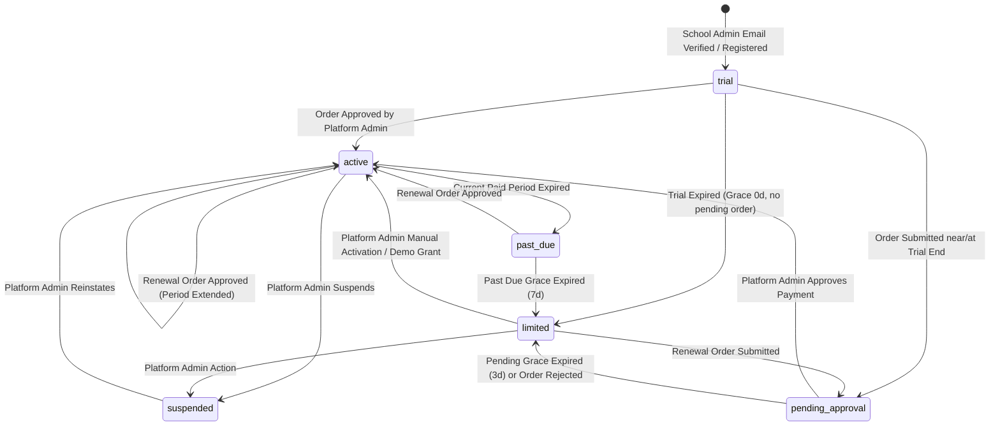

# Subscription Plans, Entitlements Engine, and Feature Locking Architecture

**Author:** Optimus Orien Architecture Team  
**Date:** November 2026  
**Document Version:** 1.0  
**Target System:** Optimus Orien SaaS (`backend` / `frontend` / `spec`)  
**Status:** Approved for Implementation (Stage 1: Design & Backend; Stage 2: User Interface)

---

## 1. Executive Summary & Core Business Decisions

Optimus Orien introduces a robust, multi-tenant subscription tiers and feature-entitlement system designed to support offline-first school billing in emerging markets alongside high-integrity, server-side feature access control.

### 1.1 Commercial & Operational Principles
1. **Pricing Preserved & Data-Driven:**
   - **Standard Plan:** \$3.60 USD / student / month. Seed PKR price: Rs 1,000 / student / month (configurable placeholder).
   - **Premium Plan:** \$7.20 USD / student / month. Seed PKR price: Rs 2,000 / student / month (configurable placeholder).
   - Plan names, marketing descriptions, feature tags, and prices are **never hardcoded in application code**. All pricing information is stored as structured records in the database (`Plan`, `PlanFeature`, `FeatureCatalog`) and managed directly by the platform admin.
   - Public pricing surfaces provide an interactive USD / PKR toggle with an explicit note that PKR amounts are approximate when derived from currency exchange rates.
2. **Billing Basis & Active Student Counting:**
   - Invoicing is calculated strictly from the number of **active, enrolled students** in the school's current active academic session at the moment the subscription order is generated.
   - Teachers, administrative staff, accountants, and parents have **unlimited access** and are never billed per seat.
   - Supported billing periods: **1 month, 3 months, 6 months, or 12 months**.
   - Optional yearly discount percentage (configurable platform-wide on `PlatformBillingSettings`, default `0%`).
3. **3-Day Comprehensive Evaluation Trial:**
   - Trial duration is **3 days** by default (configurable globally via `PlatformBillingSettings.default_trial_days`).
   - During the trial, the school receives complete, unrestricted access to **all Premium features**.
   - Trial initiation: Starts automatically when the school administrator's email is verified (or upon initial school registration if email verification is turned off in settings).
   - Extensions: Platform administrators can extend a school's trial by $N$ days with a mandatory audit reason logged in `SubscriptionEvent`.
   - Abuse Prevention: Strict rule of **one trial per school**, accompanied by best-effort heuristics preventing repeat trials by identical administrator email or verified phone number. Existing rate limits remain enforced.
   - Copy Audit: All legacy references stating "one month complimentary access" across pricing, registration, and onboarding copy are retired in favor of the dynamic 3-day trial configuration.
4. **Offline Bank Payment Approval Flow:**
   - Payment gateways (Stripe, JazzCash, EasyPaisa) are not integrated in this milestone.
   - Orders are initiated by school administrators (Owner or Org Admin). The system calculates the payable amount from the active student headcount and renders a printable offline invoice/challan containing the platform's bank account credentials (`PlatformBillingSettings`).
   - The school makes a bank transfer/deposit and submits the payment reference number, payment date, and paid amount.
   - Platform administrators review pending orders in an operational queue and explicitly Approve or Reject with an audit note. Approval activates or extends the paid subscription term.
5. **Data Preservation & Retention Guarantee:**
   - Downgrading to Standard or transitioning to a limited status **never deletes, drops, or hides tenant data**.
   - Data generated under Premium modules (such as historical AQI computations, interventions, or psych evaluations) remains safely preserved in PostgreSQL.
   - If a school upgrades or renews Premium later, historical data and full access immediately resume without data loss.

---

## 2. Feature Key Catalog & Entitlements Matrix

Each capability in Optimus Orien is identified by a standardized, machine-readable `feature_key`. The catalog defines the tier availability, development maturity status (`available`, `beta`, `coming_soon`), and corresponding system bindings.

### 2.1 Standard Plan Features (`standard`)
Available to both Standard and Premium tiers:

| Feature Key | Display Name (EN / UR) | Status | Module / Frontend Route | Backend Endpoints & Protected Views |
| :--- | :--- | :--- | :--- | :--- |
| `school_setup` | School Setup & Profile<br>اسکول سیٹ اپ | `available` | `/setup`, `/settings` | `/api/v1/onboarding/*`, `/api/v1/schools/settings/` |
| `single_campus` | Single Campus Management<br>ایک کیمپس انتظام | `available` | `/settings/campuses` | `/api/v1/campuses/` (current campus only) |
| `people_accounts` | Student & Staff Directory<br>طلباء اور عملہ کے اکاؤنٹس | `available` | `/students`, `/teachers`, `/staff` | `/api/v1/students/*`, `/api/v1/staff/*` |
| `csv_import` | CSV Bulk Data Import<br>سی ایس وی ڈیٹا درآمد | `available` | `/imports` | `/api/v1/imports/*` |
| `roles_permissions` | RBAC & Permissions Matrix<br>کردار اور اجازت نامے | `available` | `/permissions` | `/api/v1/permissions/*` |
| `attendance_daily` | Daily Attendance Tracking<br>روزانہ حاضری | `available` | `/attendance` | `/api/v1/attendance/*` |
| `marks_grading` | Marks Entry & Grading Criteria<br>نمبرات اور گریڈنگ | `available` | `/grading`, `/assessments` | `/api/v1/grading/*`, `/api/v1/assessments/*` |
| `exams_datesheets` | Exam Timetables & Schedules<br>امتحانی ڈیٹ شیٹ | `available` | `/exams` | `/api/v1/exams/*` |
| `result_cards` | Student Result Cards & Term Slips<br>نتائج کے کارڈز | `available` | `/results` | `/api/v1/exam-engine/results/*` |
| `timetable` | Class Timetable Scheduling<br>ٹائم ٹیبل | `available` | `/timetable` | `/api/v1/timetable/*` |
| `fees_offline` | Fee Structures & Counter Receipts<br>فیس چالان اور وصولی | `available` | `/fees`, `/fees/defaulters` | `/api/v1/fees/*`, `/api/v1/fees/defaulters/*` |
| `tasks_homework` | Tasks & Homework Assignments<br>ہوم ورک اور اسائنمنٹس | `available` | `/homework` | `/api/v1/homework/*` |
| `notices` | Circulars & School Announcements<br>اعلانات اور نوٹسز | `available` | `/announcements` | `/api/v1/announcements/*` |
| `portals_basic` | Basic Portals (Teacher, Student, Parent, Principal)<br>بنیادی پورٹلز | `available` | `/portal/teacher`, `/portal/student`, etc. | `/api/v1/teacher/*`, `/api/v1/student/*`, `/api/v1/parent/*`, `/api/v1/principal/*` |
| `class_subject_performance`| Class & Subject Performance<br>کلاس اور مضمون کی کارکردگی | `available` | `/analytics/class` | `/api/v1/analytics/class-subject/` |
| `trends_basic` | Current & Previous Term Trends<br>بنیادی تعلیمی رجحانات | `available` | `/analytics/trends` | `/api/v1/analytics/trends/` |
| `participation_skills_entry`| Skills & Participation Entry<br>سرگرمیاں اور صلاحیتوں کا اندراج | `available` | `/participation` | `/api/v1/participation/*` |
| `basic_reports_csv` | Basic CSV Reports Export<br>سی ایس وی رپورٹس | `available` | `/reports/csv` | `/api/v1/reports/export/csv/*` |
| `english_urdu` | Full Bilingual English & Urdu RTL<br>اردو اور انگریزی سپورٹ | `available` | Global UI Localization | All frontend routes and public templates |

### 2.2 Premium Plan Features (`premium`)
Included in Premium subscriptions and active 3-day trials; locked with HTTP 403 `feature_locked` under Standard:

| Feature Key | Display Name (EN / UR) | Status | Module / Frontend Route | Backend Endpoints & Protected Views |
| :--- | :--- | :--- | :--- | :--- |
| `aqi` | Academic Quality Index (AQI)<br>تعلیمی معیار کا اشاریہ | `available` | `/aqi` | `/api/v1/aqi/calculate/`, `/api/v1/aqi/dashboard/` |
| `aqi_history` | Longitudinal AQI Historical Trends<br>تاریخی اے کیو آئی رجحانات | `available` | `/aqi/history` | `/api/v1/aqi/history/*` |
| `early_intervention` | Early Intervention & Risk Cases<br>ابتدائی مداخلت کے کیسز | `available` | `/interventions` | `/api/v1/interventions/*`, `/api/v1/risk/` |
| `attention_indicators` | Attention & Behavioral Risk Flags<br>توجہ اور خطرے کے اشاریے | `available` | `/risk-dashboard` | `/api/v1/risk/indicators/*` |
| `automated_alerts` | Automated Academic & Attendance Alerts<br>خودکار تعلیمی انتباہات | `available` | `/alerts` | `/api/v1/alerts/*` |
| `longitudinal_5y` | 5-Year Longitudinal Student Progress<br>پانچ سالہ تفصیلی تجزیہ | `available` | `/analytics/longitudinal` | `/api/v1/analytics/5-year/*` |
| `skills_analytics` | Holistic Skills & Competency Analytics<br>مہارتوں کا جامع تجزیہ | `available` | `/analytics/skills` | `/api/v1/analytics/skills/*` |
| `behaviour_analytics` | Behavioral Analytics & Sentiment<br>رویہ کا تفصیلی تجزیہ | `available` | `/analytics/behaviour` | `/api/v1/analytics/behaviour/*` |
| `gender_equity_analytics` | Gender Parity & Equity Reporting<br>صنفی برابری کا تجزیہ | `available` | `/reports/gender` | `/api/v1/reports/gender/*` |
| `multi_campus` | Multi-Campus Operations & Aggregation<br>کثیر کیمپس انتظام | `available` | `/campuses/network` | `/api/v1/campuses/network/*` |
| `campus_comparison` | Cross-Campus Comparative Benchmarking<br>کیمپسز کا تقابلی جائزہ | `available` | `/analytics/campuses` | `/api/v1/analytics/campus-comparison/*` |
| `advanced_class_intelligence`| Advanced Class Intelligence & Quantiles<br>کلاس کی گہری بصیرت | `available` | `/analytics/intelligence` | `/api/v1/analytics/class-intelligence/*` |
| `teacher_insights` | Teacher Workload & Efficacy Insights<br>اساتذہ کی کارکردگی کی بصیرت | `available` | `/teachers/insights` | `/api/v1/teachers/insights/*` |
| `advanced_reports_export` | Formatted PDF & Excel Export Suite<br>پی ڈی ایف اور ایکسل برآمدات | `available` | `/reports/export/advanced`| `/api/v1/reports/export/pdf/*`, `/api/v1/reports/export/excel/*` |
| `accounts_ledger` | Double-Entry Accounts Ledger<br>کھاتہ جات اور لیجر | `available` | `/finance/ledger` | `/api/v1/finance/ledger/*` |
| `finance_dashboard` | Executive Finance & Cashflow Dashboard<br>مالیاتی ڈیش بورڈ | `available` | `/finance/dashboard` | `/api/v1/finance/dashboard/*` |
| `hr_payroll` | HR, Staff Salaries & Payroll Engine<br>عملہ کی تنخواہیں اور پے رول | `available` | `/payroll` | `/api/v1/payroll/*`, `/api/v1/salaries/*` |
| `admissions_online` | Online Admissions & Applicant Funnel<br>آن لائن داخلے | `available` | `/admissions` | `/api/v1/admissions/*` |
| `transport_library_inventory`| Transport, Library & Inventory Assets<br>ٹرانسپورٹ اور لائبریری | `available` | `/facilities` | `/api/v1/facilities/*` |
| `id_cards` | Bulk Student & Staff ID Card Printing<br>شناختی کارڈ پرنٹنگ | `available` | `/id-cards` | `/api/v1/id-cards/*` |
| `psych_eval` | Psychological Evaluation Module (Consent Req.)<br>نفسیاتی مشاہداتی نظام | `available` | `/psychological-evaluation` | `/api/v1/psych-eval/*` |
| `audit_log_viewer` | System Audit Log Viewer & Exporter<br>آڈٹ لاگ معائنہ کار | `available` | `/audit-logs` | `/api/v1/audit-logs/` (Backend audit logging is always active for all schools) |
| `priority_support` | Dedicated SLA Priority Support Queue<br>ترجیحی تکنیکی معاونت | `available` | `/support` | `/api/v1/support/priority/*` |

### 2.3 Coming Soon Capabilities (`coming_soon`)
These features are displayed on public and in-app matrices with an explicit **"Coming Soon"** tag and cannot be purchased or activated:
- `ai_assistant`: AI Teaching Assistant, automated quiz generator, and administrative helper.
- `online_payments`: Real-time gateway checkout for student fee challans (credit card, 1Link, mobile wallets).
- `sms_whatsapp_notifications`: Automated telco gateway dispatch for fee reminders and student absence.
- `public_leaderboards`: Inter-school academic challenges and public achievement rankings.

### 2.4 Fundamental Security & Account Safeguards (Never Locked)
Regardless of plan tier (`standard`, `premium`) or subscription status (`trial`, `limited`, `past_due`, `suspended`), the following actions remain **permanently accessible** to authenticated users:
1. User session operations: Login (`/api/v1/auth/login/`), Logout (`/api/v1/auth/logout/`), Session Check (`/api/v1/auth/me/`).
2. Own credentials management: Password update (`/api/v1/auth/password/change/`).
3. Subscription & Billing management: Accessing own plan status, reviewing invoices, submitting payment proofs (`/api/v1/subscription/*`).
4. Read-only records inspection & compliance export: School administrators, teachers, students, and parents can inspect existing records and trigger standard regulatory data exports.
5. Direct support inquiries: Submitting help requests to platform administrators.

---

## 3. Subscription Statuses & State Machine



### 3.1 Status Specifications & Entitlement Semantics

| Status Code | Description | Effective Feature Access | Write Permissions Allowed? | End-User Experience & UI State |
| :--- | :--- | :--- | :--- | :--- |
| `trial` | 3-day evaluation period granted at registration. | **All Premium Features** unlocked. | Yes (Full Read/Write) | Dismissible top countdown banner: *"Optimus Orien Premium Trial: X days remaining. Upgrade to retain uninterrupted access."* |
| `pending_approval` | Offline order submitted; awaiting bank proof verification. | **Standard Features** (Grace duration: configurable, default 3 days). | Yes (Full Read/Write on Standard) | Informational banner: *"Payment submitted for review. Order #XYZ is pending platform admin verification."* |
| `active` | Paid subscription in good standing. | Assigned Plan features (`standard` or `premium`). | Yes (Full Read/Write according to Plan) | Plan badge displayed in header: *"Standard Plan"* or *"Premium Plan"*. |
| `past_due` | Paid period concluded; school in grace period. | **Full prior plan features** (Grace duration: configurable, default 7 days). | Yes (Full Read/Write) | High-visibility warning banner: *"Subscription expired on YYYY-MM-DD. Grace period active for X more days. Please renew."* |
| `limited` | Trial or grace period concluded without active renewal. | Standard features in **Strict Read-Only Mode**. | **NO** (Writes rejected with 403 `limited_read_only`; allowlisted endpoints exempt). | Sticky warning banner: *"Account in read-only mode. New entries are disabled. Submit a payment order to restore write access."* Data is never deleted. |
| `suspended` | Administrative lockdown by platform owner. | Zero feature access. | **NO** (All authenticated requests blocked). | Full-screen suspension notice directing user to contact platform administration. |

### 3.2 Time-Based Transitions Engine
Time transitions are triggered through two complementary mechanisms:
1. **On-Demand Just-in-Time Evaluation:** Whenever `GET /api/v1/subscription/entitlements/` or a feature authorization check is invoked for a school, the entitlements service evaluates timestamps against the current server time and auto-updates the subscription state if grace or trial has elapsed.
2. **Idempotent CLI Management Command:** `python manage.py sync_subscription_states` can be run hourly/nightly via system cron or container scheduler. It iterates across all non-suspended subscriptions, advances states whose deadlines have passed, logs audit events in `SubscriptionEvent`, and emits in-app notifications.

---

## 4. Technical Data Architecture & Database Schema

### 4.1 Platform-Level Unscoped Models (Global Platform Scope)
These tables hold global definitions, pricing, and platform bank configuration. They contain **no `school_id`** column and are explicitly audited in `test_unscoped_platform_models_coverage_and_documentation`:

1. **`Plan` (`core_plan`):**
   - `id`: BigAutoField
   - `code`: CharField(max_length=50, unique=True) — `'standard'`, `'premium'`
   - `name`: CharField(max_length=100) — e.g. `'Standard Plan'`
   - `name_ur`: CharField(max_length=100) — e.g. `'اسٹینڈرڈ پلان'`
   - `description`: TextField
   - `description_ur`: TextField
   - `price_usd_per_student`: DecimalField(max_digits=8, decimal_places=2) — standard `3.60`, premium `7.20`
   - `price_pkr_per_student`: DecimalField(max_digits=10, decimal_places=2) — standard `1000.00`, premium `2000.00`
   - `is_active`: BooleanField(default=True)
   - `display_order`: PositiveIntegerField(default=0)
   - `created_at`, `updated_at`: DateTimeField

2. **`FeatureCatalog` (`core_featurecatalog`):**
   - `key`: CharField(max_length=80, primary_key=True) — machine-readable identifier (e.g. `'aqi'`, `'attendance_daily'`)
   - `name`: CharField(max_length=150)
   - `name_ur`: CharField(max_length=150)
   - `description`: TextField
   - `description_ur`: TextField
   - `category`: CharField(max_length=50) — `'core'`, `'academics'`, `'analytics'`, `'finance'`, `'safeguarding'`
   - `status`: CharField(max_length=20) — `'available'`, `'beta'`, `'coming_soon'`
   - `is_premium_only`: BooleanField(default=False)
   - `display_order`: PositiveIntegerField(default=0)

3. **`PlanFeature` (`core_planfeature`):**
   - `id`: BigAutoField
   - `plan`: ForeignKey(`Plan`, on_delete=CASCADE, related_name='features')
   - `feature_key`: CharField(max_length=80, db_index=True)
   - `is_included`: BooleanField(default=True)
   - `limits`: JSONField(default=dict, blank=True) — reserved for quantitative thresholds
   - Unique constraint: `('plan', 'feature_key')`

4. **`PlatformBillingSettings` (`core_platformbillingsettings`):**
   - `id`: BigAutoField (Singleton record ID 1)
   - `bank_name`: CharField(max_length=120) — e.g. `'Habib Bank Limited (HBL)'`
   - `account_title`: CharField(max_length=150) — e.g. `'Optimus Orien EdTech Pvt Ltd'`
   - `account_number`: CharField(max_length=50)
   - `iban`: CharField(max_length=50, blank=True)
   - `branch_code`: CharField(max_length=20, blank=True)
   - `swift_bic`: CharField(max_length=20, blank=True)
   - `payment_instructions_en`: TextField
   - `payment_instructions_ur`: TextField
   - `default_trial_days`: PositiveIntegerField(default=3)
   - `pending_grace_days`: PositiveIntegerField(default=3)
   - `past_due_grace_days`: PositiveIntegerField(default=7)
   - `yearly_discount_percentage`: DecimalField(max_digits=5, decimal_places=2, default=0.00)
   - `exchange_rate_note_en`: CharField(max_length=255, default='PKR amounts are approximate and based on standard conversion.')
   - `exchange_rate_note_ur`: CharField(max_length=255, default='روپے کی رقوم تخمینی ہیں اور مقررہ شرح تبادلہ پر مبنی ہیں۔')
   - `updated_at`: DateTimeField(auto_now=True)
   - `updated_by`: ForeignKey(`User`, null=True, on_delete=SET_NULL)

### 4.2 Tenant-Scoped Models (PostgreSQL Row Level Security Enabled)
Every tenant-scoped record is bound to a single school via `school_id`. Strict PostgreSQL RLS policies ensure tenant isolation:

1. **`SchoolSubscription` (`core_schoolsubscription`):**
   - `id`: BigAutoField
   - `school`: OneToOneField(`School`, on_delete=CASCADE, related_name='subscription')
   - `plan`: ForeignKey(`Plan`, on_delete=PROTECT, related_name='school_subscriptions')
   - `status`: CharField(max_length=25, choices=['trial', 'pending_approval', 'active', 'past_due', 'limited', 'suspended'])
   - `trial_started_at`: DateTimeField(null=True, blank=True)
   - `trial_ends_at`: DateTimeField(null=True, blank=True)
   - `current_period_start`: DateTimeField(null=True, blank=True)
   - `paid_until`: DateTimeField(null=True, blank=True)
   - `grace_until`: DateTimeField(null=True, blank=True)
   - `student_count_at_last_invoice`: PositiveIntegerField(default=0)
   - `created_at`, `updated_at`: DateTimeField

2. **`SubscriptionOrder` (`core_subscriptionorder`):**
   - `id`: BigAutoField
   - `order_number`: CharField(max_length=32, unique=True) — e.g. `'ORD-202611-0042'`
   - `school`: ForeignKey(`School`, on_delete=CASCADE, related_name='subscription_orders')
   - `plan`: ForeignKey(`Plan`, on_delete=PROTECT, related_name='orders')
   - `billing_months`: PositiveSmallIntegerField(choices=[1, 3, 6, 12])
   - `student_count`: PositiveIntegerField()
   - `unit_price`: DecimalField(max_digits=10, decimal_places=2)
   - `discount_percentage`: DecimalField(max_digits=5, decimal_places=2, default=0.00)
   - `amount`: DecimalField(max_digits=12, decimal_places=2)
   - `currency`: CharField(max_length=5, choices=['USD', 'PKR'])
   - `payment_reference`: CharField(max_length=100) — Transaction / Deposit Slip ID
   - `paid_on`: DateField()
   - `payment_notes`: TextField(blank=True)
   - `status`: CharField(max_length=20, choices=['pending', 'approved', 'rejected'], default='pending')
   - `reviewed_by`: ForeignKey(`User`, null=True, blank=True, on_delete=SET_NULL, related_name='reviewed_orders')
   - `reviewed_at`: DateTimeField(null=True, blank=True)
   - `review_note`: TextField(blank=True)
   - `created_at`, `updated_at`: DateTimeField

3. **`SchoolFeatureOverride` (`core_schoolfeatureoverride`):**
   - `id`: BigAutoField
   - `school`: ForeignKey(`School`, on_delete=CASCADE, related_name='feature_overrides')
   - `feature_key`: CharField(max_length=80, db_index=True)
   - `is_granted`: BooleanField(default=True) — True = Grant feature (even if not in plan); False = Revoke feature
   - `expires_at`: DateTimeField(null=True, blank=True)
   - `reason`: CharField(max_length=255) — Mandatory audit explanation (e.g. "Platform demo", "Commercial pilot")
   - `granted_by`: ForeignKey(`User`, on_delete=PROTECT)
   - `created_at`: DateTimeField(auto_now_add=True)
   - Unique constraint: `('school', 'feature_key')`

4. **`SubscriptionEvent` (`core_subscriptionevent`):**
   - `id`: BigAutoField
   - `school`: ForeignKey(`School`, on_delete=CASCADE, related_name='subscription_events')
   - `event_type`: CharField(max_length=50) — `'trial_started'`, `'trial_extended'`, `'order_submitted'`, `'order_approved'`, `'order_rejected'`, `'downgraded_to_limited'`, `'suspended'`, `'override_applied'`
   - `from_status`: CharField(max_length=30, blank=True)
   - `to_status`: CharField(max_length=30, blank=True)
   - `from_plan`: CharField(max_length=50, blank=True)
   - `to_plan`: CharField(max_length=50, blank=True)
   - `actor`: ForeignKey(`User`, null=True, blank=True, on_delete=SET_NULL)
   - `metadata`: JSONField(default=dict, blank=True)
   - `notes`: TextField(blank=True)
   - `created_at`: DateTimeField(auto_now_add=True)

---

## 5. Central Entitlements Service & Enforcement Rules

All feature gating is centralized in `backend/core/services/entitlements.py`. Client-side UI hides or displays controls purely as visual guidance; the backend is the authoritative security boundary.

### 5.1 Service Capabilities
```python
def get_effective_entitlements(school: School) -> dict:
    """
    Returns cached entitlements dictionary:
    {
        'plan': 'standard' | 'premium',
        'status': 'trial' | 'active' | 'past_due' | 'limited' | 'suspended',
        'is_limited': bool,
        'trial_days_remaining': int | None,
        'paid_until': str | None,
        'grace_until': str | None,
        'features': {
            'aqi': {'enabled': True, 'source': 'plan'},
            'psych_eval': {'enabled': False, 'source': 'plan', 'requires_plan': 'premium'},
            ...
        },
        'allowed_feature_keys': set([...]),
    }
    """
```

### 5.2 Server-Side Permission Class
DRF endpoints enforce feature requirements using `RequiresFeature(feature_key)`:
```python
class RequiresFeature(BasePermission):
    def __init__(self, feature_key: str):
        self.feature_key = feature_key

    def has_permission(self, request, view):
        if not request.user or not request.user.is_authenticated:
            return False
        # Platform owner / superadmins are not subject to tenant feature restrictions
        if not getattr(request.user, 'school', None):
            return True
        allowed, reason, required_plan = check_feature_entitlement(request.user.school, self.feature_key)
        if not allowed:
            raise PermissionDenied({
                'detail': f"Feature '{self.feature_key}' requires an active {required_plan} subscription.",
                'code': 'feature_locked',
                'feature_key': self.feature_key,
                'required_plan': required_plan or 'premium'
            })
        return True
```

### 5.3 Limited Mode Write-Guard Middleware
When a school enters `limited` status (due to expired trial or past-due grace without payment):
- All mutating HTTP methods (`POST`, `PUT`, `PATCH`, `DELETE`) are intercepted and blocked with HTTP 403:
  ```json
  {
    "detail": "School account is in limited read-only mode. Please renew your subscription to perform write actions.",
    "code": "limited_read_only",
    "status": "limited"
  }
  ```
- **Allowlisted Endpoints (Permanently Mutation-Safe):**
  1. `/api/v1/auth/login/`, `/api/v1/auth/logout/`
  2. `/api/v1/auth/password/change/`
  3. `/api/v1/subscription/orders/` (Allows submitting payment verification to exit limited mode)
  4. `/api/v1/public/contact/` (Allows reaching out for support)
- Read requests (`GET`, `HEAD`, `OPTIONS`) and all data export endpoints continue to function completely unimpeded for all teachers, parents, students, and administrators.

### 5.4 Cache Isolation & Invalidation Strategy
- Entitlements are cached in Redis / Django cache backend using the dedicated key format:  
  `f"entitlements:school:{school.id}"` with a 300-second TTL.
- Cache invalidation occurs immediately upon:
  1. Any status change in `SchoolSubscription`
  2. Submission or approval of a `SubscriptionOrder`
  3. Creation or expiration of a `SchoolFeatureOverride`
- Strict test verification ensures School A's cache key can never leak into or influence School B's session.

---

## 6. Complete API Endpoint Specification

### 6.1 Public Pricing & Platform Settings Endpoints
- `GET /api/v1/public/pricing/`
  - Publicly accessible (no authentication required).
  - Returns active plans, USD and PKR rates, feature breakdown, and exchange rate disclaimer.
- `GET /api/v1/public/billing-info/`
  - Publicly accessible metadata regarding platform trial policies (3-day trial text, bank transfer guidance preview).

### 6.2 School Tenant Billing Endpoints
All tenant endpoints require authenticated school administrator (`role in ['owner', 'org_admin']`).
- `GET /api/v1/subscription/current/`
  - Returns current plan, status, trial countdown, paid dates, and active student headcount.
- `GET /api/v1/subscription/entitlements/`
  - Returns effective feature keys, lock status per module, and limited-mode indicator.
- `GET /api/v1/subscription/invoice-estimate/?plan=premium&months=12`
  - Calculates live invoice estimate based on active enrolled student headcount and yearly discount.
- `POST /api/v1/subscription/orders/`
  - Submits offline payment proof: `{ plan_code, billing_months, payment_reference, paid_on, amount, currency, notes }`.
  - Creates order in `pending` status, emits `SubscriptionEvent`, transitions status to `pending_approval` (with grace).
- `GET /api/v1/subscription/orders/`
  - Returns historical payment orders and approval statuses.
- `GET /api/v1/subscription/bank-details/`
  - Returns platform bank account credentials for offline challan / wire transfer.

### 6.3 Platform Admin Console Endpoints
Restricted to platform administrator role (`request.user.role == 'platform_admin'` or `is_staff=True` with no `school_id`).
- `GET/PUT /api/v1/platform-admin/billing/settings/`
  - Manage bank account details, trial duration, grace periods, and yearly discounts.
- `GET/POST/PUT /api/v1/platform-admin/billing/plans/`
  - Manage plans and configure USD / PKR rates.
- `GET/PUT /api/v1/platform-admin/billing/features/`
  - Manage feature catalog items, categories, descriptions, and statuses.
- `GET /api/v1/platform-admin/billing/schools/`
  - Directory of all tenant schools with subscription tier, status, student count, and expiration date.
- `GET /api/v1/platform-admin/billing/orders/`
  - Operational queue of pending and historical offline orders.
- `POST /api/v1/platform-admin/billing/orders/<order_id>/approve/`
  - Approves payment, updates `paid_until`, advances status to `active`, and generates audit event.
- `POST /api/v1/platform-admin/billing/orders/<order_id>/reject/`
  - Rejects payment with audit note, notifies school.
- `POST /api/v1/platform-admin/billing/schools/<school_id>/extend-trial/`
  - Extends trial by $N$ days with required audit reason.
- `POST /api/v1/platform-admin/billing/schools/<school_id>/feature-override/`
  - Grants or revokes specific feature for demo or enterprise customization.

---

## 7. User Interface & Screen Architecture (Stage 2 Blueprint)

```
[Public Landing Page: /pricing]
   ├── USD / PKR Currency Switcher
   ├── Plan Cards (Standard vs Premium) with Student Slider Estimator
   ├── Feature Comparison Grid (Checkmarks, Crosses, "Coming Soon" Badges)
   └── Dynamic FAQ (3-Day Trial, Data Safety, Offline Bank Details)

[School In-App: /billing]
   ├── Status & Countdown Banner (Trial / Grace / Limited)
   ├── Active Enrolled Student Count Metric
   ├── Plan Comparison & Upgrade Action
   ├── Printable Bank Transfer Invoice & Deposit Slip Modal (EN / UR)
   ├── Offline Payment Submission Form (Reference #, Date, Amount)
   └── Order History & Status Timeline

[School In-App: Protected Modules]
   └── Standard Tier accessing Premium Feature (e.g. /aqi)
       └── Inline Designed Feature Lock Screen (Shield / Star Icon, Explanatory Copy, "Upgrade to Premium" CTA)

[Platform Admin: /platform-admin/subscriptions]
   ├── Platform Billing Settings Tab (Bank credentials, trial days, grace periods)
   ├── Plans & Pricing Editor (USD / PKR amounts)
   ├── Pending Offline Orders Verification Queue (Review, Approve, Reject)
   ├── School Subscriptions Roster & Health Monitor
   └── Trial Extension & Feature Override Modals
```

---

## 8. Implementation Roadmap & Effort Estimation

| Phase / Component | Key Deliverables | Estimated Effort |
| :--- | :--- | :--- |
| **Stage 1A: Backend Models & RLS** | Platform unscoped tables (`Plan`, `FeatureCatalog`, `PlatformBillingSettings`), Tenant RLS tables (`SchoolSubscription`, `SubscriptionOrder`, `SchoolFeatureOverride`, `SubscriptionEvent`), migrations, seed fixtures. | 1.5 Working Days |
| **Stage 1B: Entitlements Service & Guards** | Central `entitlements.py` calculation engine, DRF `RequiresFeature` permission, limited mode write-guard, cache invalidation, idempotent state synchronization command. | 1.5 Working Days |
| **Stage 1C: Backend Test Suite** | Plan-by-feature matrix test suite, state transition tests with mockable clock, RLS isolation verification, cache isolation test, hardcoded price reflection tests. | 1.5 Working Days |
| **Stage 2A: Public Pricing & Landing UI** | Dynamic USD/PKR pricing toggle, comparison matrix, 3-day trial copy integration, FAQ updates, registration plan preselection. | 1.5 Working Days |
| **Stage 2B: School Billing & Lock Screens** | School billing dashboard, printable offline deposit challan, order submission modal, designed in-app lock screens for Premium modules, limited-mode banners. | 1.5 Working Days |
| **Stage 2C: Platform Admin Console & E2E** | Platform billing settings editor, order approval/rejection queue, trial extension modal, Playwright end-to-end testing across registration, trial, lock, order, and approval. | 1.0 Working Days |
| **Total Engineering Effort** | **Comprehensive Full-Stack Implementation** | **~8.5 Working Days** |

---
*End of Design & Entitlements Specification. Proceeding to Stage 1 backend implementation.*
