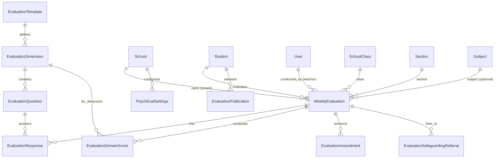

# Psychological Evaluation Module — Implementation Architecture & Plan

**Document Version:** 1.0  
**Status:** Draft — Awaiting User Approval (Stage 0)  
**Specification Reference:** [spec/PSYCH_EVAL_SPEC.md](file:///d:/optimus-orien/optimus-orien/spec/PSYCH_EVAL_SPEC.md)  
**Traceability Reference:** [spec/PSYCH_EVAL_TRACEABILITY.md](file:///d:/optimus-orien/optimus-orien/spec/PSYCH_EVAL_TRACEABILITY.md)  
**Permission Matrix:** [design/psych-eval/permission-matrix.md](file:///d:/optimus-orien/optimus-orien/design/psych-eval/permission-matrix.md)

---

## 1. Audit of Previous Attempt

### 1.1 Existing Artifacts Inspected
The previous implementation attempt created the following files:
1. **Database Schema & Migrations:**
   - Migration `backend/core/migrations/0024_evaluationdimension_evaluationtemplate_and_more.py` created tables:
     `evaluation_templates`, `evaluation_dimensions`, `evaluation_questions`, `weekly_evaluations`, `evaluation_responses`, `evaluation_domain_scores`, `evaluation_publications`, `evaluation_audit_logs`, `evaluation_safeguarding_referrals`.
   - Models are defined in `backend/core/models.py` (lines 1653–1887).
   - *Crucial note:* Migrations `0025`, `0026`, and `0027` depend directly on `0024`.
2. **Backend Service & Views:**
   - `backend/core/services/psychological_evaluation.py` (1080 lines).
   - `backend/core/psychological_evaluation_views.py` (754 lines).
   - `backend/core/urls.py` (lines 235–249 routes endpoints under `/api/v1/psychological-evaluations/`).
3. **Tests:**
   - `backend/core/tests/test_psychological_evaluation.py` (19 automated tests passing).
4. **Seed Command:**
   - `backend/core/management/commands/seed_psychological_evaluations.py`.
5. **Frontend:**
   - `frontend/src/PsychologicalEvaluation.tsx` (2042 lines, Recharts radar/line charts, tabs for dashboard, class, workspace, student, safeguarding, audit).
   - Wired in `frontend/src/main.tsx` for pages `'Psychological Evaluation'` and `'My Development Profile'`.

### 1.2 What to Reuse vs. What to Rewrite / Enhance
- **To Reuse:**
  - Base schema structure of `EvaluationTemplate`, `EvaluationDimension`, `EvaluationQuestion`, `WeeklyEvaluation`, `EvaluationResponse`, `EvaluationPublication`, `EvaluationSafeguardingReferral`, and `EvaluationAuditLog`.
  - The URL routing namespace `/api/v1/psychological-evaluations/`.
  - Base test scaffolding in `test_psychological_evaluation.py`.
  - Visual presentation foundations (radar chart axes, layout structure) in `PsychologicalEvaluation.tsx`.
- **To Rewrite / Enhance:**
  - **Data Model & Migrations:**
    - Do *not* delete or rewind existing migrations `0024`–`0027`. Add a new forward migration (`0028_psych_eval_enhancements.py`) that:
      - Adds `EvaluationAmendment` model (preserves original submitted record; tracks revisions and reasons).
      - Adds `PsychEvalSettings` (or settings fields on `School`): `psych_eval_enabled` (default False), `acknowledged_by`, `acknowledged_at`, `acknowledgement_text_version`, `week_start_day` (default Monday), `min_cohort_size` (default 5), `subject_teachers_can_view_combined_profile` (default False), `publisher_roles` (default owner, org_admin, principal, class_teacher), `retention_period_days`.
      - Converts `EvaluationDomainScore.normalized_score` to high-precision `DecimalField` (avoiding floating-point drift).
      - Adds Urdu translation fields (`question_text_ur`, `dimension_name_ur`, `instructions_ur`, `disclaimer_ur`).
      - Sets up PostgreSQL Row-Level Security (RLS) policies on all tenant tables (`weekly_evaluations`, `evaluation_responses`, `evaluation_domain_scores`, `evaluation_publications`, `evaluation_safeguarding_referrals`, `evaluation_amendments`).
  - **Scoring Engine:**
    - Rewrite calculation engine to use pure Python `Decimal` with strict zero intermediate rounding; unobserved null responses strictly excluded; domain requires $\ge 2$ valid responses; no overall score, no risk scores, no clinical labels.
    - Combined multi-teacher profile: arithmetic mean of unrounded domain scores across eligible teacher evaluations; requires $\ge 2$ teachers per domain with valid scores, otherwise display single-teacher observation or "Insufficient observations".
  - **Authorization & Capability Enforcement:**
    - Implement server-side capability decorator checking `psych_eval.*` keys.
    - Enforce Platform Admin aggregate-only view (minimum cohort size rule $\ge 5$); break-glass mechanism with owner audit.
  - **UI Accessibility & Localization:**
    - Add bilingual support (English and Urdu with RTL support).
    - Add accessible semantic HTML tabular alternative alongside the radar chart (WCAG AA compliance).
    - Add strict banned-word scanner test for negative labels and clinical/diagnostic terms.

---

## 2. Target Data Model & Schema

### 2.1 Unscoped Reference Tables (Platform-Level Reference Data)
- **`evaluation_templates`**: Versioned, immutable once published. Fields: `version` (unique), `name`, `status` ('active', 'archived'), `effective_from`, `effective_to`, `validation_status`, `instructions_en`, `instructions_ur`, `disclaimer_en`, `disclaimer_ur`.
- **`evaluation_dimensions`**: 6 dimensions per template. Fields: `template_id`, `dimension_key`, `dimension_name_en`, `dimension_name_ur`, `description_en`, `description_ur`, `display_order`.
- **`evaluation_questions`**: 18 positively framed questions (3 per dimension). Fields: `dimension_id`, `question_text_en`, `question_text_ur`, `display_order`, `active`.

### 2.2 Tenant-Scoped Evaluation Tables (Protected by RLS and `school_id`)
- **`weekly_evaluations`**:
  - `id` (PK)
  - `school_id` (FK to `School`, indexed, RLS tenant anchor)
  - `campus_id` (FK to `School`, null=True)
  - `student_id` (FK to `Student`, indexed)
  - `teacher_id` (FK to `User`, indexed)
  - `school_class_id` (FK to `SchoolClass`)
  - `section_id` (FK to `Section`, null=True)
  - `subject_id` (FK to `Subject`, null=True)
  - `observation_context` (`class_teacher_general` or `subject_specific`)
  - `evaluation_week` (`YYYY-MM-DD` or ISO week string, indexed)
  - `template_version` (FK / CharField to `EvaluationTemplate.version`)
  - `status` (`draft`, `submitted`, `revised`)
  - `submitted_at` (DateTimeField, null=True)
  - `strengths_observed`, `support_areas`, `support_action` (TextFields)
  - `teacher_notes` (Confidential internal text, never exposed to students)
  - `student_visible_feedback` (Approved constructive feedback)
  - `feedback_approved` (BooleanField, default False)
  - `current_amendment_id` (FK to `EvaluationAmendment`, null=True)
  - Constraints: Partial unique index on `(school_id, student_id, teacher_id, evaluation_week, observation_context, subject_id)`.
- **`evaluation_responses`**:
  - `id` (PK)
  - `evaluation_id` (FK to `WeeklyEvaluation`, cascade)
  - `question_id` (FK to `EvaluationQuestion`)
  - `response_value` (SmallIntegerField: 1–5 or NULL for unobserved; null never equals 0)
  - `observation_note` (Optional brief note)
  - Constraint: Unique on `(evaluation_id, question_id)`.
- **`evaluation_domain_scores`**:
  - `id` (PK)
  - `evaluation_id` (FK to `WeeklyEvaluation`, cascade)
  - `dimension_id` (FK to `EvaluationDimension`)
  - `valid_response_count` (SmallInt: 0..3)
  - `average_response` (DecimalField, max_digits=5, decimal_places=4, null=True)
  - `normalized_score` (DecimalField, max_digits=6, decimal_places=2, null=True)
  - `score_status` (`valid` or `insufficient`)
  - Constraint: Unique on `(evaluation_id, dimension_id)`.
- **`evaluation_amendments`**:
  - `id` (PK)
  - `evaluation_id` (FK to `WeeklyEvaluation`)
  - `revision_number` (PositiveIntegerField)
  - `amended_by` (FK to `User`)
  - `amended_at` (DateTimeField)
  - `reason` (TextField)
  - `previous_responses_snapshot` (JSONField: snapshot of questions and responses before change)
  - `previous_scores_snapshot` (JSONField)
- **`evaluation_publications`**:
  - `id` (PK)
  - `school_id` (FK to `School`)
  - `student_id` (FK to `Student`)
  - `evaluation_week` (CharField)
  - `published_by` (FK to `User`)
  - `published_at` (DateTimeField)
  - `visibility_status` (`published`, `unpublished`)
  - Constraint: Unique on `(student_id, evaluation_week)`.
- **`evaluation_safeguarding_referrals`**:
  - `id` (PK)
  - `school_id` (FK to `School`)
  - `student_id` (FK to `Student`)
  - `referred_by` (FK to `User`)
  - `evaluation_id` (FK to `WeeklyEvaluation`, null=True)
  - `urgency_level` (`standard`, `high`, `immediate`)
  - `concern_description` (TextField)
  - `status` (`submitted`, `under_review`, `action_taken`, `closed`)
  - `designated_lead_notes` (TextField)
- **`evaluation_audit_logs`**:
  - `id` (PK)
  - `actor_id` (FK to `User`, null=True)
  - `action` (`view`, `submit`, `amend`, `publish`, `unpublish`, `export`, `setting_change`, `referral_access`)
  - `record_type`, `record_id`, `timestamp`, `relevant_metadata` (no sensitive student note text in metadata).
- **`psych_eval_settings`**:
  - `school_id` (OneToOne to `School`)
  - `enabled` (BooleanField, default False)
  - `acknowledged_by` (FK to `User`, null=True)
  - `acknowledged_at` (DateTimeField, null=True)
  - `acknowledgement_text_version` (CharField)
  - `week_start_day` (CharField: 'monday' or 'saturday', default 'monday')
  - `min_cohort_size` (PositiveIntegerField, default 5)
  - `subject_teachers_can_view_combined_profile` (BooleanField, default False)
  - `publisher_roles` (JSONField: default `['owner', 'organisation_admin', 'principal', 'class_teacher']`)
  - `retention_period_days` (PositiveIntegerField, default 365 * 3)

---

## 3. Server-Side Permission Matrix Summary

All access is governed by the 13 capability keys documented in `permission-matrix.md`:
1. **Platform Admin:** Aggregate statistics only across schools (cohort rule $\ge 5$), zero access to student names/evaluations except via time-limited break-glass session with owner consent.
2. **Owner / Org Admin:** Full governance over all campuses in their own organisation.
3. **Principal:** Scoped strictly to their assigned campus.
4. **Class Teacher:** Scoped to actively assigned class/section.
5. **Subject Teacher:** Scoped to assigned class & subject.
6. **Student:** Own published profile only. Internal notes, unpublished evaluations, teacher identities, referrals, and peer data are strictly omitted.
7. **Parent / Accountant:** Completely excluded in v1.

---

## 4. API Endpoints Specification

All endpoints reside under `/api/v1/psychological-evaluations/` and require valid JWT/session authentication.

| Method | Path | Required Capability | Description & Scoping |
| :--- | :--- | :--- | :--- |
| `GET` | `template/` | `authenticated` | Returns active 18-item observation questionnaire, dimensions, instructions, and validation status in active locale (en/ur). |
| `GET` | `overview/` | `psych_eval.view_aggregates` | Level 1 (School/System) & Level 2 (Campus) overview: completion rates, evaluated student counts, insufficient counts, campus comparisons. |
| `GET` | `class-summary/` | `psych_eval.view_class` | Level 3 (Class Overview): student list, evaluation statuses (Not Started, Draft, Submitted, Revised), class domain averages. |
| `GET` | `student-profile/<int:student_id>/` | `psych_eval.view_class` or `psych_eval.view_campus` | Level 4: 6D radar chart data, combined multi-teacher score, period comparison, single-teacher observations, historical trend lines. |
| `GET` | `my-profile/` | `student` | Student self-service: latest published radar chart, historical trend, approved feedback. Excludes internal notes & teacher info. |
| `GET` | `workspace/` | `psych_eval.submit` | Teacher weekly workspace: assigned classes/subjects, student evaluation checklist, draft/submission indicators. |
| `GET` | `evaluations/find/` | `psych_eval.submit` or `psych_eval.view_class` | Retrieve single evaluation detail and responses by `student_id`, `week`, `context`, `subject_id`. |
| `POST` | `evaluations/save/` | `psych_eval.submit` | Save draft or submit evaluation. Enforces scope, unobserved null handling, duplicate prevention, and automatic score calculation. |
| `POST` | `evaluations/<int:pk>/amend/` | `psych_eval.amend` | Create an amendment for an existing submitted evaluation, recording reason, snapshotting old responses, and logging audit trail. |
| `POST` | `publications/publish/` | `psych_eval.publish` | Toggle publication visibility (`published` / `unpublished`) of a student's weekly profile. |
| `GET` | `gender-analytics/` | `psych_eval.view_aggregates` | Optional gender aggregate metrics. Minimum cohort size rule ($\ge 5$) applied; N/A returned for small groups; no inference. |
| `POST` | `safeguarding/refer/` | `psych_eval.referral.create` | Submit confidential safeguarding concern to designated school lead. Independent of scores. |
| `GET` | `safeguarding/list/` | `psych_eval.referral.view` | List and triage safeguarding referrals (locked to designated safeguarding personnel). |
| `PATCH` | `safeguarding/<int:pk>/status/` | `psych_eval.referral.view` | Update safeguarding referral status and designated lead notes. |
| `GET` | `audit-logs/` | `psych_eval.view_audit` | View evaluation audit trail filtered by school/date/actor. |
| `GET` | `export/` | `psych_eval.export` | Generate restricted, audited CSV export of anonymised or authorised evaluation records. |
| `GET` | `settings/` | `psych_eval.manage_settings` | Get school module configuration, onboarding status, and week start preferences. |
| `POST` | `settings/` | `psych_eval.manage_settings` | Update school module settings (e.g. enable module with owner acknowledgement). |

---

## 5. UI Screen Architecture

1. **Teacher Weekly Evaluation Workspace (`mode = 'workspace'`):**
   - Filters: Assigned Class selector, Assigned Subject selector, Evaluation Week selector.
   - Student Checklist table: Student Name, Admission ID, Status badge (`Not Started`, `Draft`, `Submitted`, `Revised`), Last Updated, Action button (`Evaluate`, `Resume Draft`, `View`, `Request Amendment`).
   - Evaluation Modal:
     - Header banner: Administration instructions verbatim + validation disclaimer.
     - 18 questions grouped into 6 collapsible dimension sections.
     - Likert frequency radio group: 1 (Never), 2 (Rarely), 3 (Sometimes), 4 (Frequently), 5 (Consistently) + "Not Observed / Insufficient Opportunity" (stored as null).
     - Teacher Reflections: Strengths Observed, Areas for Support, Suggested Classroom Support Action.
     - Confidential Staff Notes (strictly private).
     - Student-Visible Feedback + explicit "Approve for student viewing" toggle.
     - Action buttons: "Save Draft", "Submit Evaluation" (prompts confirmation: "Submitted evaluations become immutable records").
2. **Hierarchy Dashboards (`mode = 'dashboard'`):**
   - Level 1 & 2: KPI Strip (Completion Rate, Total Evaluated, Insufficient Observations count, Active Classes). Campus comparison cards, multi-week completion rate trend.
   - Level 3 (Class Summary): Class-level domain profile radar chart, student status grid, class average scores.
3. **Student Profile Modal / View (`mode = 'student'`):**
   - Title: "Student Behavioural & Development Profile"
   - Subtitle: Verbatim disclaimer.
   - Spider-Web / Radar Chart (6 axes, 0–100 scale, hover values, distinct visual pattern for Insufficient Observations).
   - Week selector and "Compare with previous week" split-view.
   - Contributor badge: e.g. "Combined multi-teacher profile (3 teachers)" or "Single-teacher observation".
   - Accessible Semantic HTML Table Alternative: toggled by button or rendered below for screen readers.
   - Multi-week Historical Trend Line Chart.
   - Publication status toggle (for authorized staff).
4. **Student Portal Page ("My Development Profile"):**
   - Dedicated clean student view accessible at `/app` -> "My Development Profile".
   - Displays latest published radar chart, historical trend line, encouraging approved feedback.
   - Completely omits teacher identities, internal notes, referrals, and peer comparisons.
5. **Safeguarding Referral Modal & Review Console (`mode = 'safeguarding'`):**
   - Discreet, restricted form accessible from teacher workspace ("Safeguarding Concern").
   - Lead Console for triage and notes.
6. **Module Settings & Owner Onboarding Modal:**
   - Onboarding modal requiring owner signature checkbox: "I confirm school authorization and parent/guardian communication have been completed prior to activating student behavioural evaluations."

---

## 6. Caching and Invalidation Architecture

- **Cache Keys:**
  - Tenant and scope isolated: `psych_eval:v1:{school_id}:overview:{week}:{campus_id}`
  - Class summary: `psych_eval:v1:{school_id}:class:{class_id}:{week}`
  - Combined profile: `psych_eval:v1:{school_id}:student_profile:{student_id}:{week}`
- **TTL:** 10 minutes for aggregate overviews, 5 minutes for student combined profiles.
- **Invalidation Triggers:**
  - Upon `save_evaluation` (submit or draft): Invalidate student combined profile, class summary, and campus overview.
  - Upon `amend_evaluation`: Invalidate student profile and class summary.
  - Upon `publish_evaluation` / `unpublish`: Invalidate student public profile cache.
  - Cross-school isolation guarantee: Cache keys always prepend `school_id`; a test explicitly asserts no data leakage across schools or scopes.

---

## 7. Audit Events & Compliance Logging

Audit records are created via `EvaluationAuditLog` with action types:
- `EVALUATION_VIEW`: Logged when an authorized staff member views an individual student's evaluation history.
- `EVALUATION_DRAFT_SAVE`: Logged on saving draft responses.
- `EVALUATION_SUBMIT`: Logged on official immutable submission.
- `EVALUATION_AMEND`: Logged with reason, revision number, and actor when an amendment is recorded.
- `PROFILE_PUBLISH` / `PROFILE_UNPUBLISH`: Logged on student publication state changes.
- `SAFEGUARDING_REFERRAL_CREATE` / `SAFEGUARDING_REFERRAL_VIEW`: Logged with actor and student ID (excluding confidential text from metadata).
- `EVALUATION_EXPORT`: Logged on CSV download with filter parameters and record count.
- `SETTINGS_CHANGE`: Logged on module enable/disable or threshold adjustments.

---

## 8. Privacy Settings & Free-Text Security

1. **Application-Level Encryption Proposal:**
   - Free-text fields containing sensitive subjective observations (`teacher_notes`, `safeguarding_concern`, `designated_lead_notes`) can be encrypted at rest in the database using AES-256-GCM via a dedicated Django model field or Fernet cipher with key `PSYCH_EVAL_ENCRYPTION_KEY`.
   - *Status:* Proposed for owner confirmation before activation.
2. **Automated Data Retention Purge Command:**
   - `python manage.py purge_expired_psych_evals [--dry-run] [--school-id=X]`
   - Purges evaluations older than `retention_period_days` (default 3 years / 1095 days) according to configured school policy, preserving anonymised aggregate statistics and audit logs.
3. **Banned Negative Words Test:**
   - Automated test scanning all database fixtures, seed files, source code, and API response serializers for prohibited negative personality labels ("Bad Personality", "Weak Student", "Aggressive", "Introvert", "Low Intelligence", "Psychologically Unstable", and diagnostic labels).

---

## 9. Effort Estimates & Implementation Schedule

| Stage | Focus Area | Best Case | Likely Case | Worst Case |
| :--- | :--- | :---: | :---: | :---: |
| **Stage 0** | Audit & Planning (Complete) | 0.5 days | 0.5 days | 1.0 day |
| **Stage 1** | Schema enhancements (amendments, settings, RLS, Decimal scoring, seed) | 1.0 day | 1.5 days | 2.0 days |
| **Stage 2** | Teacher Workspace API & UI, drafts, immutability, amendments, permissions | 1.5 days | 2.0 days | 2.5 days |
| **Stage 3** | Combined profiles, radar/line charts, accessible tables, student portal view | 1.5 days | 2.0 days | 3.0 days |
| **Stage 4** | Hierarchy dashboards L1–L3, completion rates, gender analytics, caching | 1.0 day | 1.5 days | 2.0 days |
| **Stage 5** | Safeguarding console, audit viewer, export, retention purge, banned-words test | 1.0 day | 1.5 days | 2.0 days |
| **Total** | | **6.5 days** | **8.5 days** | **12.5 days** |

---

## 10. Risk Analysis & Mitigations

1. **Risk: Intermediate Float Rounding causing Radar Chart Misalignment**
   - *Mitigation:* Pure `Decimal` arithmetic with no intermediate rounding; format only at final serializer output.
2. **Risk: Unobserved items falsely skewing scores downwards**
   - *Mitigation:* Explicit null check; `None` excluded from both sum and divisor; minimum 2 valid items required.
3. **Risk: Confidential teacher notes leaking into student portal**
   - *Mitigation:* Explicit student serializer strictly whitelisting public fields; negative automated test asserting key absence.
4. **Risk: Performance degradation on large multi-campus schools**
   - *Mitigation:* Composite indexes `(school_id, evaluation_week, student_id)`, query budgets, and scope-safe caching.
5. **Risk: Cross-school or Cross-teacher authorization leakage**
   - *Mitigation:* Server-side capability checks, PostgreSQL RLS policies, and rigorous multi-tenant test suites.
