# Record & Teacher Performance Modules — Inventory & Implementation Plan

**Document Version:** 1.0  
**Status:** Approved for Stage 0 Review  
**Specification References:** [design/old-design-tokens.md](file:///d:/optimus-orien/optimus-orien/design/old-design-tokens.md), [design/plans-and-entitlements.md](file:///d:/optimus-orien/optimus-orien/design/plans-and-entitlements.md)  
**Target Systems:** Optimus Orien Web Backend (`backend/core/`), React Frontend (`frontend/src/`)  

---

## 1. Executive Summary & Architectural Principles

This document sets out the comprehensive architecture, data inventory, gap analysis, data models, API contracts, screen layouts, permission matrices, and implementation plan for two new modules in Optimus Orien:
1. **Module A: Record (`ریکارڈ`)** — A permanent, filterable, audit-backed reporting and lifecycle history layer across Campuses, Staff, Students, Fees, Income & Expenses, and Salaries for School Owners, Organisation Admins, and Principals.
2. **Module B: Teacher Performance (`اساتذہ کی کارکردگی`)** — A supportive, fair, evidence-based academic performance and early intervention system for evaluating teaching impact using published examination results, cohort value-added progress, versioned criteria, and principal-guided workflows.

### 1.1 Non-Negotiable Core Rules
- **Rule 1: Zero Data Duplication.** The Record module does NOT replicate existing relational entities (no cloned student, staff, fee, or financial records). It functions as a high-performance reporting query layer over single sources of truth, complemented by append-only lifecycle event tables where historical change logs do not exist.
- **Rule 2: Append-Only Lifecycle Architecture.** Historical events (admissions, promotions, withdrawals, transfers, hiring, resignations, terminations) are strictly append-only. Hard deletes are prohibited across all historical models. Corrections are executed either via explicit amendments (linking to the prior entry) or by voiding with a mandatory documented rationale. Every create, amend, and void operation is audited with actor, timestamp, and field changes—never free-text personal notes in general system logs.
- **Rule 3: Enforced Server-Side Access & Scope.** Principals are strictly bounded to their assigned campus; any request attempting to access or filter by another campus ID is rejected server-side with HTTP 403/404 (with automated tampering tests). Individual salary line items are masked from Principals by default, exposing only campus aggregates unless explicitly unlocked by the Owner.
- **Rule 4: Formula-Safe Streaming Excel (.xlsx) Downloads.** Exports are generated server-side in memory via `openpyxl` (version 3.1.5, MIT license, already installed in `backend/venv`), featuring dual sheets ("Summary" and "Data"), formula injection neutralization (`=`, `+`, `-`, `@`, `\t`, `\r` prefixes escaped with single quotes), frozen headers, auto-filters, formatted dates/currencies, 50,000 row caps, and full UTF-8 / Urdu localization.
- **Rule 5: Fairness & Developmental Language.** Teacher performance evaluation uses published examination results only. Wording is strictly developmental ("On track", "Watch", "Needs support") with a zero-tolerance banned-word test for punitive labels ("bad", "incompetent", "failing") in both English and Urdu. Alerts require explicit human confirmation by the Principal before becoming active.
- **Rule 6: Design Token Parity.** All user interfaces conform strictly to the legacy design system defined in `design/old-design-tokens.md` (`--brand-purple-primary: #9b51e0`, `--bg-canvas-light: #f7f9fc`, Inter font family, pill buttons, responsive collapsed mobile filter sheets, and WCAG AA contrast).

---

## 2. Inventory of Existing Code & Single Source of Truth Mapping

A full inspection of the existing codebase (`backend/core/models.py`, `backend/core/services/`, `backend/core/views*.py`, `backend/plans/`) reveals the existing sources of truth:

| Data Item | Single Source of Truth (Existing Model) | Existing Files & Services | What Exists Today | What is Missing / Gaps |
| :--- | :--- | :--- | :--- | :--- |
| **Staff Profiles & Employment** | `core.models.StaffMember` | `backend/core/models.py`<br>`backend/core/staff.py`<br>`core/services/access.py` | `StaffMember` has `first_name`, `last_name`, `email`, `phone`, `position`, `role`, `teacher_type`, `status` ('active', 'terminated'), `hired_on`, `terminated_on`. Basic changelog `StaffEvent` (hired, promoted, role_changed, terminated, reinstated). | Detailed lifecycle event history (joined, resigned, terminated, contract ended, retired, transferred, rejoined); campus transfer routing (`from_campus`, `to_campus`); restricted termination notes; role-gated visibility; configurable reason categories. |
| **Student Profiles & Enrollments** | `core.models.Student`<br>`core.models.Enrollment` | `backend/core/models.py`<br>`backend/core/views.py`<br>`core/services/access.py` | `Student` (`admission_number`, `first_name`, `last_name`, `gender`, `enrolled_on`, `active`). `Enrollment` (`school_class`, `section`, `start_date`, `end_date`). | Append-only student lifecycle transitions table (`StudentLifecycleEvent`); tracking of promotions, graduations ("passed out"), academic year repetitions ("not promoted (repeating)"), and withdrawals ("left": struck off, migrated, transferred out); validation state machine. |
| **Student Transfers** | Event recorded via `record_event(action='transfer')` | `backend/core/views.py`<br>(`transfer_student`) | Student school pointer is updated; audit log records action. | Dedicated append-only lifecycle event linking the previous campus, target campus, effective date, and reason category. |
| **Fees, Vouchers & Defaulters** | `core.models.StudentFee`<br>`core.models.FeePayment`<br>`core.models.FeePaymentAllocation` | `backend/core/models.py`<br>`backend/core/fees.py`<br>`backend/core/views_finance.py` | Full fee billing structure: `FeeHead`, `FeeStructure`, `StudentFee` (period, amount_due, discount, status: unpaid, partial, paid, waived, void), `FeePayment` (receipts, cash/bank/cheque/online), and `FeePaymentAllocation`. | Multi-year historical rollup view; unified filtering across billing periods, payment modes, classes, and campuses; streaming Excel export with summary cards. |
| **Income & Expenses** | `core.models.FinanceCategory`<br>`core.models.FinanceEntry` | `backend/core/models.py`<br>`backend/core/finance.py` | `FinanceCategory` (kind: income/expense), `FinanceEntry` (amount, date, description, voided, created_by). Paid fees automatically generate linked `FinanceEntry` (Income). Paid salaries automatically generate linked `FinanceEntry` (Expense). | Long-term multi-campus historical ledger reporting layer; category-wise monthly breakdowns; net balance calculations; rate-limited streaming Excel downloads. |
| **Salaries & Payroll** | `core.models.SalaryStructure`<br>`core.models.SalaryRecord`<br>`core.models.SalaryAdjustment` | `backend/core/models.py`<br>`backend/core/salaries.py` | `SalaryStructure` (basic, allowances, deductions, effective_from). `SalaryRecord` (staff, month YYYY-MM, gross, net, status: draft/pending/approved/paid/void, method: bank/cash/cheque, paid_on). Links to `FinanceEntry`. | Role-sensitive line masking (Principals see campus totals, line items hidden unless owner unlocks); multi-campus historical summary reporting; dedicated Record export format. |
| **Assessments & Exam Results** | `core.models.ExamStructure`<br>`core.models.ExamTerm`<br>`core.models.CalculatedSubjectResult`<br>`core.models.SubjectResult`<br>`core.models.PublishedResult` | `backend/core/models.py`<br>`backend/core/services/aqi_engine.py`<br>`backend/core/services/exam_engine.py` | Configurable exam structures, term weightages, full-precision normalized subject percentages, published snapshot verifications (`PublishedResult`), AQI class/campus/school averages. | Teacher performance aggregation layer: aggregating published results per teacher, per class/subject and session/term; calculating deltas vs campus and school subject averages; cohort value-added intake tracking. |
| **Subject-Teacher Assignments** | `core.models.ClassSubjectTeacher`<br>`core.models.TeachingAssignment`<br>`core.models.ClassTeacherAssignment` | `backend/core/models.py`<br>`backend/core/services/teacher_scope.py` | Maps teachers to classes, sections, and subjects with validity date ranges (`start_date`, `end_date`). | Historical teacher assignment mapping tied to past academic terms to ensure teacher metrics reflect exact historical assignments. |
| **Interventions & Risk Criteria** | `core.models.RiskCriteria`<br>`core.models.RiskDismissal`<br>`core.models.ReviewCase` | `backend/core/models.py`<br>`backend/core/views_risk.py` | Versioned student risk criteria, combine modes, live evaluation, flag dismissal rationale, and review cases. | Versioned Teacher Performance Criteria (`TeacherPerformanceCriteria`); live impact preview; teacher alert lifecycle (`TeacherPerformanceAlert`) requiring Principal human confirmation. |
| **Audit Logging** | `core.models.AuditEvent` | `backend/core/models.py`<br>`backend/core/services/audit.py` | Structured audit trail: `actor`, `organisation`, `school`, `action`, `resource`, `resource_id`, `changes`. Strips free-text notes. | Dedicated action hooks for lifecycle event creation, amendment, voiding, and Record export logging. |
| **Universal Exports** | `core.services.exports.export_response` | `backend/core/services/exports.py` | CSV and single-sheet XLSX generator using `openpyxl`, formula injection prefix protection, 50k row limit. | Dual-sheet Excel generator ("Summary" sheet with metadata and totals + "Data" sheet with frozen headers and auto-filters); column capability gating. |
| **Subscription & Entitlements** | `core.models.PlatformBillingSettings`<br>`core.models.FeatureCatalog`<br>`core.models.PlanFeature`<br>`core.models.SchoolSubscription` | `backend/core/models.py`<br>`backend/core/services/entitlements.py`<br>`core/services/feature_permissions.py` | Dynamic tiered feature locking (`no_plan`, `standard`, `premium`, `custom`). Decorator `@requires_feature(key)`. Feature keys: `fees_offline`, `accounts_ledger`, `hr_payroll`, `teacher_insights`. | Mapping Record sub-pages to standard/premium tiers; adding granular permission capability keys to `OrganisationRolePolicy`. |

---

## 3. Gap Analysis & What is Missing

### 3.1 Missing Tables & Models
1. **`LifecycleReasonCategory`**: Master configurable lookup table for event reasons (e.g., Staff: "Relocation", "Better Opportunity", "Retirement", "Contract Expiry", "Disciplinary"; Student: "Family Relocation", "Financial Hardship", "Transferred to Boarding", "Medical").
2. **`StaffLifecycleEvent`**: Append-only lifecycle ledger for staff members (joined, resigned, terminated, contract ended, retired, transferred, rejoined), campus transfer link (`from_campus`, `to_campus`), effective date, reason category, restricted notes, amendment/void tracking.
3. **`StudentLifecycleEvent`**: Append-only lifecycle ledger for students linked to enrollments (admitted, promoted, passed out, not promoted (repeating), left with sub-types: withdrawn, transferred out, struck off, migrated), effective date, reason category, notes, amendment/void tracking.
4. **`TeacherPerformanceCriteria`**: Versioned evaluation rule configuration per school/organisation (thresholds for campus diff, term drop, pass rate, minimum students $N$, minimum assessments $M$), rationale note, and parent version link.
5. **`TeacherPerformanceAlert`**: Lifecycle tracking for teacher support alerts (`suggested` $\rightarrow$ `open` $\rightarrow$ `acknowledged` $\rightarrow$ `under_review` $\rightarrow$ `resolved` $\rightarrow$ `dismissed`). Crucially, the system never activates an alert automatically; it suggests it to the Principal who must confirm it.
6. **`TeacherPerformanceNote`**: Role-segregated notes: Principal/Owner private notes (hidden from teacher) vs. Teacher self-reflection notes (visible to teacher and leadership).

### 3.2 Missing Logic & Engine Capabilities
1. **Student State Machine Validator**: Enforces valid academic lifecycle transitions (e.g. an active student can be promoted or withdrawn; a student marked "left" or "passed out" cannot be promoted without readmission).
2. **Teacher Performance Metrics Service**: Computes class averages, student counts, assessment counts, pass rates, term-over-term deltas, difference from campus and school averages, and "same students over time" (value-added intake context) using ONLY published results (`PublishedResult` and `CalculatedSubjectResult`).
3. **Bilingual Neutral Language Scanner**: Automated test suite scanning all code, templates, and criteria labels to ensure zero punitive wording (guaranteeing "On track", "Needs support", "Watch" and forbidding "bad", "incompetent", "failing" in English and Urdu).
4. **Multi-Sheet Formula-Safe Excel Writer**: Dedicated builder generating `.xlsx` workbooks containing both a formatted "Summary" sheet (school info, filters, generation metadata, aggregate totals) and a "Data" sheet (frozen header, auto-filter, typed cells, totals row).

---

## 4. Target Data Model & Database Schema

```mermaid
erDiagram
    School ||--o{ StaffLifecycleEvent : "campus"
    StaffMember ||--o{ StaffLifecycleEvent : "has_events"
    User ||--o{ StaffLifecycleEvent : "recorded_by"
    
    School ||--o{ StudentLifecycleEvent : "campus"
    Student ||--o{ StudentLifecycleEvent : "has_events"
    Enrollment ||--o{ StudentLifecycleEvent : "links_enrollment"
    AcademicYear ||--o{ StudentLifecycleEvent : "session"
    SchoolClass ||--o{ StudentLifecycleEvent : "class"
    Section ||--o{ StudentLifecycleEvent : "section"
    User ||--o{ StudentLifecycleEvent : "recorded_by"
    
    School ||--o{ TeacherPerformanceCriteria : "configures"
    User ||--o{ TeacherPerformanceAlert : "teacher"
    School ||--o{ TeacherPerformanceAlert : "campus"
    TeachingAssignment ||--o{ TeacherPerformanceAlert : "assignment"
    User ||--o{ TeacherPerformanceAlert : "confirmed_by"
    
    School ||--o{ TeacherPerformanceNote : "campus"
    User ||--o{ TeacherPerformanceNote : "teacher"
    User ||--o{ TeacherPerformanceNote : "author"
```



### 4.1 Model Specifications

#### A. `LifecycleReasonCategory`
- `id`: AutoField (PK)
- `school`: FK to `School` (null=True for organisation-wide default presets)
- `target_type`: CharField(max_length=16, choices=[('staff', 'Staff'), ('student', 'Student')])
- `code`: CharField(max_length=40)
- `name_en`: CharField(max_length=120)
- `name_ur`: CharField(max_length=120)
- `is_active`: BooleanField(default=True)
- `display_order`: PositiveSmallIntegerField(default=0)

#### B. `StaffLifecycleEvent` (Append-Only)
- `id`: AutoField (PK)
- `staff`: FK to `StaffMember`, on_delete=models.PROTECT, related_name='lifecycle_events'
- `school`: FK to `School`, on_delete=models.PROTECT, related_name='staff_lifecycle_events' (current/primary campus)
- `from_campus`: FK to `School`, null=True, blank=True, on_delete=models.PROTECT, related_name='+' (transfers)
- `to_campus`: FK to `School`, null=True, blank=True, on_delete=models.PROTECT, related_name='+' (transfers)
- `event_type`: CharField(max_length=24, choices=[
    ('joined', 'Joined'),
    ('resigned', 'Resigned'),
    ('terminated', 'Terminated'),
    ('contract_ended', 'Contract Ended'),
    ('retired', 'Retired'),
    ('transferred', 'Transferred'),
    ('rejoined', 'Rejoined')
  ])
- `effective_date`: DateField(db_index=True)
- `reason_category`: ForeignKey to `LifecycleReasonCategory`, null=True, blank=True, on_delete=models.SET_NULL
- `reason_text`: CharField(max_length=255, blank=True, default='')
- `restricted_notes`: TextField(blank=True, default='', help_text="Confidential notes visible ONLY to Owner and Org Admin for terminations")
- `recorded_by`: FK to `User`, null=True, on_delete=models.SET_NULL, related_name='+'
- `amends`: FK to 'self', null=True, blank=True, on_delete=models.PROTECT, related_name='amendments'
- `is_void`: BooleanField(default=False, db_index=True)
- `void_reason`: CharField(max_length=255, blank=True, default='')
- `voided_by`: FK to `User`, null=True, blank=True, on_delete=models.SET_NULL, related_name='+'
- `voided_at`: DateTimeField(null=True, blank=True)
- `created_at`: DateTimeField(auto_now_add=True)
- `updated_at`: DateTimeField(auto_now=True)

#### C. `StudentLifecycleEvent` (Append-Only)
- `id`: AutoField (PK)
- `student`: FK to `Student`, on_delete=models.PROTECT, related_name='lifecycle_events'
- `enrollment`: FK to `Enrollment`, null=True, blank=True, on_delete=models.PROTECT, related_name='lifecycle_events'
- `school`: FK to `School`, on_delete=models.PROTECT, related_name='student_lifecycle_events'
- `academic_year`: FK to `AcademicYear`, on_delete=models.PROTECT, related_name='+'
- `school_class`: FK to `SchoolClass`, on_delete=models.PROTECT, related_name='+'
- `section`: FK to `Section`, null=True, blank=True, on_delete=models.SET_NULL, related_name='+'
- `event_type`: CharField(max_length=24, choices=[
    ('admitted', 'Admitted / Enrolled'),
    ('promoted', 'Promoted'),
    ('passed_out', 'Passed out (Graduated)'),
    ('not_promoted', 'Not promoted (repeating)'),
    ('left', 'Left')
  ])
- `leave_subtype`: CharField(max_length=24, blank=True, default='', choices=[
    ('withdrawn', 'Withdrawn'),
    ('transferred_out', 'Transferred Out'),
    ('struck_off', 'Struck Off'),
    ('migrated', 'Migrated')
  ])
- `effective_date`: DateField(db_index=True)
- `reason_category`: ForeignKey to `LifecycleReasonCategory`, null=True, blank=True, on_delete=models.SET_NULL
- `notes`: TextField(blank=True, default='')
- `recorded_by`: FK to `User`, null=True, on_delete=models.SET_NULL, related_name='+'
- `amends`: FK to 'self', null=True, blank=True, on_delete=models.PROTECT, related_name='amendments'
- `is_void`: BooleanField(default=False, db_index=True)
- `void_reason`: CharField(max_length=255, blank=True, default='')
- `voided_by`: FK to `User`, null=True, blank=True, on_delete=models.SET_NULL, related_name='+'
- `voided_at`: DateTimeField(null=True, blank=True)
- `created_at`: DateTimeField(auto_now_add=True)
- `updated_at`: DateTimeField(auto_now=True)

#### D. `TeacherPerformanceCriteria` (Versioned)
- `id`: AutoField (PK)
- `school`: FK to `School`, on_delete=models.CASCADE, related_name='teacher_performance_criteria'
- `name`: CharField(max_length=160, default='Standard Supportive Criteria')
- `version`: PositiveIntegerField(default=1)
- `active`: BooleanField(default=True)
- `min_students`: PositiveSmallIntegerField(default=10, help_text="Minimum students in class/subject to evaluate")
- `min_assessments`: PositiveSmallIntegerField(default=2, help_text="Minimum published assessments required")
- `diff_campus_threshold`: DecimalField(max_digits=5, decimal_places=2, default=Decimal('10.00'), help_text="Points below campus subject average")
- `drop_term_threshold`: DecimalField(max_digits=5, decimal_places=2, default=Decimal('8.00'), help_text="Points drop compared to prior term")
- `pass_rate_threshold`: DecimalField(max_digits=5, decimal_places=2, default=Decimal('60.00'), help_text="Pass rate benchmark %")
- `explanation_of_change`: TextField(blank=True, default='')
- `previous_version`: FK to 'self', null=True, blank=True, on_delete=models.SET_NULL, related_name='successor_versions'
- `created_by`: FK to `User`, null=True, on_delete=models.SET_NULL, related_name='+'
- `created_at`: DateTimeField(auto_now_add=True)

#### E. `TeacherPerformanceAlert` (Support Lifecycle)
- `id`: AutoField (PK)
- `school`: FK to `School`, on_delete=models.PROTECT, related_name='teacher_performance_alerts'
- `teacher`: FK to `User`, on_delete=models.PROTECT, related_name='performance_alerts'
- `teaching_assignment`: FK to `TeachingAssignment`, null=True, blank=True, on_delete=models.SET_NULL, related_name='+'
- `school_class`: FK to `SchoolClass`, on_delete=models.PROTECT, related_name='+'
- `subject`: FK to `Subject`, on_delete=models.PROTECT, related_name='+'
- `academic_year`: FK to `AcademicYear`, on_delete=models.PROTECT, related_name='+'
- `term_name`: CharField(max_length=80)
- `criteria_version`: PositiveIntegerField(default=1)
- `trigger_reason`: CharField(max_length=255)
- `status`: CharField(max_length=20, choices=[
    ('suggested', 'Suggested (Pending Principal Review)'),
    ('open', 'Open'),
    ('acknowledged', 'Acknowledged'),
    ('under_review', 'Under Review'),
    ('resolved', 'Resolved'),
    ('dismissed', 'Dismissed')
  ], default='suggested')
- `confirmed_by`: FK to `User`, null=True, blank=True, on_delete=models.SET_NULL, related_name='+'
- `confirmed_at`: DateTimeField(null=True, blank=True)
- `action_plan`: TextField(blank=True, default='', help_text="Supportive action plan or mentoring notes")
- `resolved_by`: FK to `User`, null=True, blank=True, on_delete=models.SET_NULL, related_name='+'
- `resolved_at`: DateTimeField(null=True, blank=True)
- `created_at`: DateTimeField(auto_now_add=True)
- `updated_at`: DateTimeField(auto_now=True)

#### F. `TeacherPerformanceNote`
- `id`: AutoField (PK)
- `school`: FK to `School`, on_delete=models.PROTECT, related_name='teacher_performance_notes'
- `teacher`: FK to `User`, on_delete=models.PROTECT, related_name='received_performance_notes'
- `author`: FK to `User`, on_delete=models.PROTECT, related_name='authored_performance_notes'
- `kind`: CharField(max_length=24, choices=[
    ('private_leadership', 'Private Leadership Note (Owner & Principal only)'),
    ('self_reflection', 'Teacher Self-Reflection (Teacher & Principal)')
  ])
- `academic_year`: FK to `AcademicYear`, null=True, blank=True, on_delete=models.SET_NULL
- `term_name`: CharField(max_length=80, blank=True, default='')
- `content`: TextField()
- `created_at`: DateTimeField(auto_now_add=True)
- `updated_at`: DateTimeField(auto_now=True)

---

## 5. Granular Role-by-Role Permission Matrix

### 5.1 Capability Keys Definition
The following keys are registered in the central policy engine (`backend/core/services/access.py`) and validated against `OrganisationRolePolicy`:

- `records.view_staff`: View staff directory history and lifecycle events.
- `records.view_students`: View student admission, promotion, repetition, and leave records.
- `records.view_fees`: View fee billing rolls, collection breakdowns, and defaulter histories.
- `records.view_finance`: View income and expense entries, net balances, and categories.
- `records.view_salaries`: View salary totals (principals view totals; individual lines require owner enablement).
- `records.view_salary_lines`: View detailed individual staff salary lines (Owner/Org Admin default; Principal opt-in).
- `records.view_terminated_notes`: View confidential notes on terminated staff (Owner and Org Admin only).
- `records.manage`: Manually record past lifecycle events or void existing entries with mandatory justification.
- `records.export`: Stream and download formula-safe Excel workbooks (.xlsx).
- `teacher_performance.view_summary`: Access the Teacher Performance Overview and distribution metrics.
- `teacher_performance.view_detail`: View assigned class performance breakdowns and historical trend sparklines.
- `teacher_performance.manage_criteria`: Edit versioned performance risk rules with live preview.
- `teacher_performance.manage_alerts`: Confirm suggested alerts, transition alert status, and record support plans.
- `teacher_performance.view_own`: Allow teachers to view their own summary and reflection cards (when enabled).
- `teacher_performance.private_notes`: View and record private leadership observation notes.

### 5.2 Role Matrix Table

| Capability | Platform Admin | Owner / Org Admin | Principal (Assigned Campus) | Teacher (Self) | Teacher (Other) | Student / Parent | Accountant |
| :--- | :---: | :---: | :---: | :---: | :---: | :---: | :---: |
| `records.view_staff` | ❌ (Unscoped) | ✅ (All Campuses) | ✅ (Own Campus Only) | ❌ | ❌ | ❌ | ❌ |
| `records.view_students` | ❌ (Unscoped) | ✅ (All Campuses) | ✅ (Own Campus Only) | ❌ | ❌ | ❌ | ❌ |
| `records.view_fees` | ❌ (Unscoped) | ✅ (All Campuses) | ✅ (Own Campus Only) | ❌ | ❌ | ❌ | ✅ (Assigned Campus) |
| `records.view_finance` | ❌ (Unscoped) | ✅ (All Campuses) | ✅ (Own Campus Only) | ❌ | ❌ | ❌ | ✅ (Assigned Campus) |
| `records.view_salaries` | ❌ (Unscoped) | ✅ (All Campuses) | ✅ (Totals Only) | ❌ | ❌ | ❌ | ❌ |
| `records.view_salary_lines`| ❌ (Unscoped) | ✅ (All Campuses) | Optional (Owner Switch)| ❌ | ❌ | ❌ | ❌ |
| `records.view_terminated_notes`| ❌ | ✅ (Owner/Org Admin) | ❌ (Forbidden) | ❌ | ❌ | ❌ | ❌ |
| `records.manage` | ❌ | ✅ | ✅ (Own Campus Only) | ❌ | ❌ | ❌ | ❌ |
| `records.export` | ❌ | ✅ (Audited) | ✅ (Audited, Own Campus)| ❌ | ❌ | ❌ | ✅ (Fees/Finance only)|
| `teacher_performance.view_summary`| ❌ | ✅ (All Campuses) | ✅ (Own Campus Only) | ❌ | ❌ | ❌ | ❌ |
| `teacher_performance.view_detail` | ❌ | ✅ (All Campuses) | ✅ (Own Campus Only) | ❌ | ❌ | ❌ | ❌ |
| `teacher_performance.manage_criteria`| ❌ | ✅ | ✅ (Own Campus) | ❌ | ❌ | ❌ | ❌ |
| `teacher_performance.manage_alerts` | ❌ | ✅ | ✅ (Confirms/Reviews) | ❌ | ❌ | ❌ | ❌ |
| `teacher_performance.view_own` | ❌ | ❌ | ❌ | ✅ (If Enabled) | ❌ (Strictly Blocked)| ❌ | ❌ |
| `teacher_performance.private_notes`| ❌ | ✅ | ✅ | ❌ | ❌ | ❌ | ❌ |

---

## 6. Complete API Specifications

All endpoints run under `/api/v1/` and enforce HTTP 401 for unauthenticated calls and HTTP 403 for unauthorized access or campus tampering. Date ranges and months adhere to the `Asia/Karachi` timezone.

### 6.1 Module A: Record Endpoints

#### 1. Overview Summary & Rolling Comparisons
- **Endpoint:** `GET /api/v1/records/overview/`
- **Capabilities Required:** `records.view_staff`, `records.view_students`, `records.view_fees`, `records.view_finance`
- **Query Parameters:** `campus` (int, required for org admin if multi-campus; fixed for principal), `academic_year` (int), `calendar_year` (int), `month` (YYYY-MM), `start_date` (YYYY-MM-DD), `end_date` (YYYY-MM-DD).
- **Response Format:**
  ```json
  {
    "meta": { "campus_id": 1, "campus_name": "Main Campus", "period": "2026-01-01 to 2026-11-17", "tz": "Asia/Karachi" },
    "cards": {
      "staff": { "joined": 5, "resigned": 1, "terminated": 1, "transferred": 2, "net_change": 3 },
      "students": { "admitted": 120, "promoted": 410, "not_promoted": 12, "passed_out": 45, "left": 18, "active_total": 520 },
      "fees": { "billed": "1560000.00", "collected": "1420000.00", "waived": "40000.00", "outstanding": "100000.00", "collection_rate": 91.03 },
      "finance": { "income": "1450000.00", "expense": "980000.00", "net": "470000.00" },
      "salaries": { "total_paid": "650000.00", "staff_count": 32 }
    },
    "monthly_summary": [
      { "month": "2026-10", "admitted": 8, "left": 2, "billed": "150000.00", "collected": "142000.00", "income": "142000.00", "expense": "95000.00", "net": "47000.00", "salaries": "65000.00" }
    ],
    "yearly_summary": [
      { "year": 2025, "admitted": 95, "left": 20, "billed": "1400000.00", "collected": "1310000.00", "net": "380000.00" },
      { "year": 2026, "admitted": 120, "left": 18, "billed": "1560000.00", "collected": "1420000.00", "net": "470000.00" }
    ],
    "yoy_comparison": {
      "admissions_growth_pct": 26.32,
      "collection_growth_pct": 8.40,
      "net_margin_change_pct": 23.68
    }
  }
  ```

#### 2. Staff Lifecycle Records
- **Endpoint:** `GET /api/v1/records/staff/`
- **Capabilities Required:** `records.view_staff`
- **Query Parameters:** `campus`, `event_type`, `reason_category`, `search`, `start_date`, `end_date`, `page`, `page_size`.
- **Response Format:** Paginated rows. The field `restricted_notes` is stripped if the user is not Owner or Org Admin.

#### 3. Student Lifecycle Records
- **Endpoint:** `GET /api/v1/records/students/`
- **Capabilities Required:** `records.view_students`
- **Query Parameters:** `campus`, `academic_year`, `school_class`, `section`, `event_type`, `search`, `page`, `page_size`.
- **Response Format:** Paginated rows with neutral labels (e.g. `event_type_display: "Not promoted (repeating)"`).

#### 4. Fees Record & Defaulters
- **Endpoint:** `GET /api/v1/records/fees/`
- **Capabilities Required:** `records.view_fees`
- **Query Parameters:** `campus`, `academic_year`, `month`, `school_class`, `payment_mode` (cash, bank, cheque, online), `defaulters_only` (bool), `page`, `page_size`.

#### 5. Income & Expenses Record
- **Endpoint:** `GET /api/v1/records/finance/`
- **Capabilities Required:** `records.view_finance`
- **Query Parameters:** `campus`, `category_id`, `kind` (income/expense), `month`, `start_date`, `end_date`, `page`, `page_size`.

#### 6. Salaries Record
- **Endpoint:** `GET /api/v1/records/salaries/`
- **Capabilities Required:** `records.view_salaries`
- **Query Parameters:** `campus`, `month`, `search`, `page`, `page_size`.
- **Access Rule:** If `records.view_salary_lines` is False for the user, individual rows return masked values (`gross: "***"`, `net: "***"`), but the summary header returns accurate campus totals.

#### 7. Manual Entry, Amendments & Voiding
- **Endpoint:** `POST /api/v1/records/events/staff/` (Create manual past event)
- **Endpoint:** `POST /api/v1/records/events/students/` (Create manual past event)
- **Endpoint:** `POST /api/v1/records/events/<staff|student>/<id>/void/` (Void with required reason)
- **Capabilities Required:** `records.manage`

#### 8. Multi-Sheet Streaming Excel Export
- **Endpoint:** `GET /api/v1/records/export/`
- **Capabilities Required:** `records.export`
- **Query Parameters:** `page_type` (`overview`, `staff`, `students`, `fees`, `finance`, `salaries`), plus identical filter parameters to screen query.
- **Output:** Streamed `.xlsx` binary with filename `record_<page>_<campus>_<period>_<yyyymmdd>.xlsx`.

---

### 6.2 Module B: Teacher Performance Endpoints

#### 1. Performance Overview & Benchmarks
- **Endpoint:** `GET /api/v1/teacher-performance/overview/`
- **Entitlement:** `@requires_feature('teacher_insights')`
- **Capabilities Required:** `teacher_performance.view_summary`
- **Query Parameters:** `campus`, `academic_year`, `term_name`, `search`, `status_filter` (`on_track`, `watch`, `needs_support`, `insufficient_data`).
- **Response Format:**
  ```json
  {
    "meta": { "campus_id": 1, "term": "First Term 2026", "published_only": true },
    "cards": {
      "evaluated_teachers": 28,
      "on_track_count": 22,
      "watch_count": 4,
      "needs_support_count": 2,
      "insufficient_data_count": 3
    },
    "distribution": [
      { "band": "90% - 100%", "count": 6 },
      { "band": "75% - 89%", "count": 14 },
      { "band": "60% - 74%", "count": 6 },
      { "band": "Below 60%", "count": 2 }
    ],
    "teachers": [
      {
        "teacher_id": 104,
        "name": "Sarah Ahmed",
        "assigned_classes_count": 3,
        "total_students_evaluated": 75,
        "published_assessments_count": 4,
        "composite_average": 78.40,
        "diff_campus_subject_avg": 3.20,
        "term_delta": 2.10,
        "value_added_intake_delta": 4.50,
        "status": "on_track",
        "has_active_alert": false
      }
    ]
  }
  ```

#### 2. Teacher Detailed Evaluation
- **Endpoint:** `GET /api/v1/teacher-performance/teachers/<id>/`
- **Capabilities Required:** `teacher_performance.view_detail` (or `teacher_performance.view_own` if viewing self)
- **Response Format:** Assigned classes/subjects breakdown, historical term trend sparklines, value-added comparisons, past support alerts, and notes.

#### 3. Versioned Risk Criteria & Live Impact Preview
- **Endpoint:** `GET /api/v1/teacher-performance/criteria/`
- **Endpoint:** `POST /api/v1/teacher-performance/criteria/`
- **Endpoint:** `POST /api/v1/teacher-performance/criteria/preview/` (Calculates live how many teachers and classes match proposed rules before saving)
- **Capabilities Required:** `teacher_performance.manage_criteria`

#### 4. Alerts Lifecycle Management
- **Endpoint:** `GET /api/v1/teacher-performance/alerts/`
- **Endpoint:** `POST /api/v1/teacher-performance/alerts/<id>/action/` (`confirm`, `acknowledge`, `resolve`, `dismiss`)
- **Capabilities Required:** `teacher_performance.manage_alerts`

---

## 7. UI / UX Design & Screen Inventory

### 7.1 Styling Tokens & Old Admin Look
In accordance with `design/old-design-tokens.md` and `frontend/src/style.css`:
- **Color Palette:**
  - Primary Purple: `#9b51e0` (glow: `rgba(155, 81, 224, 0.3)`)
  - Deep Purple: `#6f42c1`
  - Canvas Background: `#f7f9fc`
  - Surface White: `#ffffff` with border `#e5e5e5`
  - Subtle Surface: `#f8f9fa`
  - Supportive Status Pills:
    - *On track*: Background `#dcfce7`, Text `#15803d`, Border `#86efac`
    - *Watch*: Background `#fef9c3`, Text `#854d0e`, Border `#fde047`
    - *Needs support*: Background `#fee2e2`, Text `#b91c1c`, Border `#fca5a5`
    - *Insufficient data*: Background `#f1f5f9`, Text `#64748b`, Border `#cbd5e1`
- **Typography & Font:** `'Inter', -apple-system, sans-serif`. Numbers rendered with tabular lining figures (`font-variant-numeric: tabular-nums`).
- **Urdu / RTL Support:** Direction switched to `rtl` when Urdu is selected (`dir="rtl"`), font family switches smoothly to Urdu Naskh/Nastaliq system fallbacks, mirror navigation and table alignments.
- **Mobile-First Collapsible Filter Sheet:** On screens $< 768\text{px}$, filters condense into a clean slide-over drawer triggered by a *"Filter"* button. The *"Download Excel"* button remains pinned and reachable.

### 7.2 Screen Breakdown

| Screen ID | Title (EN / UR) | Primary Elements & Widgets | Actions & Exports |
| :--- | :--- | :--- | :--- |
| **SCR-REC-01** | Record Overview<br>ریکارڈ کا جائزہ | 5 High-level KPI cards (Staff, Students, Fees, Finance, Salaries); Year-over-Year comparison badge; Monthly rolling trend chart; Yearly rollup table. | Date range picker; Session selector; Campus switcher; "Download Overview (.xlsx)" button. |
| **SCR-REC-02** | Staff Record<br>عملہ کا ریکارڈ | Staff event history table; event badges (Joined, Resigned, Terminated, Transferred, Rejoined); from/to campus badges for transfers; pagination. | Filter by event type, reason, search; "Record Past Event" modal; "Void Event" dialog; "Download Staff Record (.xlsx)". |
| **SCR-REC-03** | Student Record<br>طلباء کا ریکارڈ | Enrollment and academic event table; neutral labels ("Not promoted (repeating)", "Passed out"); transition history modal; class & section breadcrumbs. | Filter by session, class, section, event type; "Record Lifecycle Change" modal; "Download Student Record (.xlsx)". |
| **SCR-REC-04** | Fees Record<br>فیسوں کا ریکارڈ | Defaulters tab & Collection rolls tab; collection rate gauge; payment mode breakdown (Cash, Bank, Online, Cheque); month/class cross-filters. | Filter by payment status, mode, class; Defaulter reminder triggers; "Download Fee Register (.xlsx)". |
| **SCR-REC-05** | Income & Expenses<br>آمدن و اخراجات کا ریکارڈ | Dual-ledger summary cards; category-wise income vs. expense stacked bar chart; net balance indicator; detailed chronologic transaction table. | Filter by category, kind, date range; "Download Ledger (.xlsx)". |
| **SCR-REC-06** | Salaries Record<br>تنخواہوں کا ریکارڈ | Campus salary disbursement totals card; role-masked employee payroll register; payment method distribution; sensitivity disclosure banner. | Filter by month, search; Reveal toggle (Owner only); "Download Payroll Record (.xlsx)". |
| **SCR-TP-01** | Teacher Performance Overview<br>اساتذہ کی کارکردگی کا جائزہ | Evaluated teachers KPI; Support distribution bar chart; Subject benchmark gap comparison; Teacher summary list with status pills ("On track", "Watch", "Needs support"). | Term filter; Campus filter; Search; "Criteria & Preview" button; "Download Performance Summary (.xlsx)". |
| **SCR-TP-02** | Teacher Performance Detail<br>استاد کی تفصیلی کارکردگی | Teacher profile header; assigned classes/subjects matrix with class averages, diffs, and intake values; sparkline term trend; active/past alerts drawer. | "Add Supportive Observation" modal; "Confirm Suggested Alert" action; "Download Teacher Dossier (.xlsx)". |
| **SCR-TP-03** | Criteria & Live Impact Preview<br>معیارات اور لائیو جائزہ | Interactive threshold sliders and inputs ($N$ students, $M$ assessments, drop points, campus diff); real-time count preview; version explanation input. | "Test Live Impact" button; "Publish Version" confirmation; historical version diff link. |
| **SCR-TP-04** | Teacher Self-Reflection View<br>میری تدریسی کارکردگی | Neutral self-view for logged-in teacher (if setting enabled); personal assigned class averages; self-reflection notes area; developmental guidance. | "Save Reflection Note" button. |

---

## 8. Excel (.xlsx) Streaming Export Architecture

### 8.1 Technical Architecture
- **Library:** `openpyxl` (version 3.1.5, MIT license, pre-installed). Runs in write-only or streaming memory mode (`io.BytesIO()`) and directly streams the HTTP response without caching files on the server disk.
- **Formula Injection Neutralization:**
  ```python
  INJECTION_CHARS = ('=', '+', '-', '@', '\t', '\r')
  def sanitize_cell(value):
      if value is None or isinstance(value, (int, float, Decimal, bool)):
          return value
      s = str(value)
      if s and s[0] in INJECTION_CHARS:
          return "'" + s
      return s
  ```
- **Dual-Sheet Specification:**
  1. **Sheet 1: "Summary"**:
     - Institution / Campus Name & Code
     - Report Title & Page Category
     - Applied Filters (Session, Date Range, Class, Category, Search Query)
     - Generation Metadata: Generated By (Username, Role), Timestamp (`Asia/Karachi`), Total Row Count
     - High-Level Aggregate Totals (e.g. Total Billed, Total Collected, Total Net Margin, Net Staff Delta)
  2. **Sheet 2: "Data"**:
     - Header Row frozen at `A2` with brand purple / slate styling (`#1E293B`, bold white font).
     - Excel Auto-Filter activated across all data columns.
     - Strong data typing: real dates (`YYYY-MM-DD`), numeric currency (`#,##0.00`), integer counts.
     - Bottom Totals row with Excel `=SUM(...)` or calculated aggregate values.
     - Auto-calculated column widths with safety clamps (minimum 12, maximum 45).
     - Full UTF-8 support for Urdu names and notes.
- **Safety & Row Capping:**
  - Hard limit of 50,000 rows. If query exceeds 50,000, returns HTTP 413: *"Export exceeds maximum allowed limit of 50,000 rows. Please refine your date or class filters."*
  - UI shows live indicator: *"N rows will be exported"*. Button is disabled with tooltip if $N = 0$.
  - Short modal confirmation prompt before download initiates: *"This file contains sensitive operational/financial records. Confirm export?"*
  - Dedicated audit log entry for every export: actor, school, page type, filter parameters, and row count (zero PII logged).

---

## 9. Fairness Rules & Bilingual Banned-Word Scan

Teacher performance evaluations directly impact educators' livelihoods and morale. The system adheres to strict ethical guardrails:
1. **Minimum Data Thresholds:** Evaluations only trigger if a class/subject has at least $N$ students (default 10) and $M$ published assessments (default 2). If below threshold, status is marked strictly as *"Insufficient data"* with no alert generated.
2. **Contextual Transparency:** Raw scores are never displayed in isolation. The UI always displays class size, number of assessments, prior term averages, and subject averages across the school.
3. **Automated Banned-Word Test:** Automated CI/CD test scanning all translation files, UI copy, and system labels to guarantee forbidden terms are never used:
   - *Forbidden English words:* `bad`, `incompetent`, `failing`, `loser`, `punish`, `demote`, `poor teacher`, `substandard`.
   - *Forbidden Urdu words:* `نااہل`, `برا استاد`, `ناکام`, `سزا`, `گھٹیا`.
   - *Approved Developmental Terms:* `On track` (`بہتر سمت میں`), `Watch` (`زیرِ نگاہ`), `Needs support` (`معاونت کی ضرورت`), `Insufficient data` (`ناکافی ڈیٹا`).
4. **Mandatory Human-in-the-Loop Confirmation:** The system never unilaterally creates active alerts. The evaluation engine generates a `suggested` alert visible only to the Principal, who must review context and confirm before it becomes active.

---

## 10. Performance, Query Budgets & Timezone Handling

- **Timezone Standard:** All day/month calculations use `Asia/Karachi` time (UTC+5). Month boundary filters parse from `00:00:00` on the 1st of the month to `23:59:59.999999` on the last day in Karachi time before converting to database UTC timestamps.
- **Query Count Budgets:**
  - Record Overview API: $\le 6$ database queries (using `aggregate()` and `select_related()`).
  - Record List Views: $\le 4$ database queries (1 query for count, 1 query with `select_related`/`prefetch_related` for rows, 1 policy query, 1 school scope query).
  - Teacher Performance Overview: $\le 5$ database queries.
- **URL & Session Synchronization:** Filter state in React synchronizes with URL query parameters via `useSearchParams`, allowing bookmarking, browser back/forward navigation, and session persistence across page refreshes.

---

## 11. Effort Estimation (Working Days)

| Phase / Component | Best Case | Likely Case | Worst Case |
| :--- | :---: | :---: | :---: |
| **Phase 1: Database Models & Migrations**<br>Schema, RLS, lifecycle models, criteria, alerts, notes, audit hooks | 1.5 days | 2.0 days | 3.0 days |
| **Phase 2: Backend Engines & Security**<br>State machine validator, teacher performance engine, access capability integration | 2.0 days | 3.0 days | 4.0 days |
| **Phase 3: Multi-Sheet Streaming Excel Service**<br>Dual-sheet writer, formula sanitizer, capability column masking, row limits | 1.0 day | 1.5 days | 2.5 days |
| **Phase 4: API Endpoints & Parity Tests**<br>Record APIs, Teacher Performance APIs, tamper tests, query budget tests | 2.0 days | 3.0 days | 4.5 days |
| **Phase 5: Frontend Record Screens (Part A)**<br>Overview, Staff, Students, Fees, Finance, Salaries, mobile filter sheet | 3.0 days | 4.0 days | 5.5 days |
| **Phase 6: Frontend Teacher Performance Screens (Part B)**<br>Dashboard, Teacher Detail, Criteria Manager with Live Preview, Self-View | 2.5 days | 3.5 days | 5.0 days |
| **Phase 7: End-to-End Verification & Banned-Word Scans**<br>Bilingual Urdu/English audit, Playwright tests, PostgreSQL regression tests | 1.5 days | 2.0 days | 3.0 days |
| **TOTAL EFFORT** | **13.5 days** | **19.0 days** | **27.5 days** |

---

## 12. Stage 0 Clarification Questions for User Review

Please review and provide guidance on the following numbered questions before we commence Stage 1 implementation:

1. **Backfilling Past History:** Should past years of student admissions, promotions, and staff joining dates be back-filled by a dedicated CSV import tool, or should the initial deployment populate current active enrollments and staff as "Joined / Admitted" automatically?
2. **Principal Salary Visibility:** By default, principals see only total campus salary expenditure, while individual staff salary lines are hidden unless unlocked by the Owner. Should this default behavior be confirmed as the standard out-of-the-box configuration?
3. **Teacher In-App Notification of Support Alerts:** When a principal confirms a "Needs support" or "Watch" alert for a teacher, should the teacher receive an in-app notification with the supportive action plan, or should alerts remain strictly an administrative leadership tool?
4. **Default Minimum Evaluation Thresholds:** Are the suggested defaults of **10 students** per class/subject and **2 published assessments** per term acceptable as the system default before calculating performance metrics?
5. **Excel Export Column Exclusions:** Should any specific columns (such as staff personal phone numbers, CNIC/ID numbers, or fee waiver reasons) be permanently excluded from Excel downloads regardless of user permissions?
