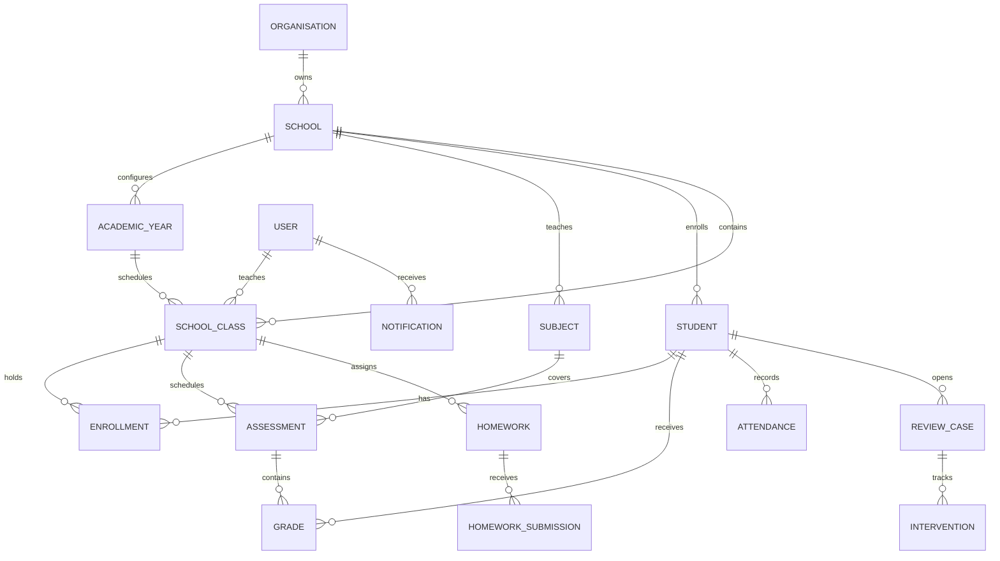

# Architecture reference

## Entity relationships (simplified)

## Request flow

`Browser → /api/v1 → Django session/CSRF middleware → DRF authenticated route → scoped queryset → validated Django model → SQLite (development) / PostgreSQL (production)`.

## Module layout

`backend/core/models.py`: relational structures; `backend/core/views.py`: serializers, scoped resources, dashboard/reports; `backend/core/management/commands/seed_demo.py`: development fixtures; `backend/core/tests`: initial isolation tests; `frontend/src/main.tsx`: typed UI/screens; `frontend/src/api.ts`: typed HTTP functions; `frontend/src/style.css`: responsive design system.

This is a small monolith rather than a microservice system. No background queues, object store or third-party data exchange is implemented. Add these after operational requirements and data-governance rules have been established.
