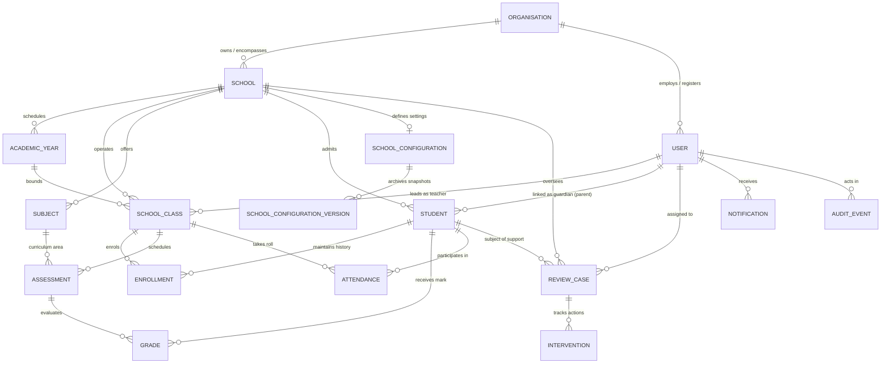
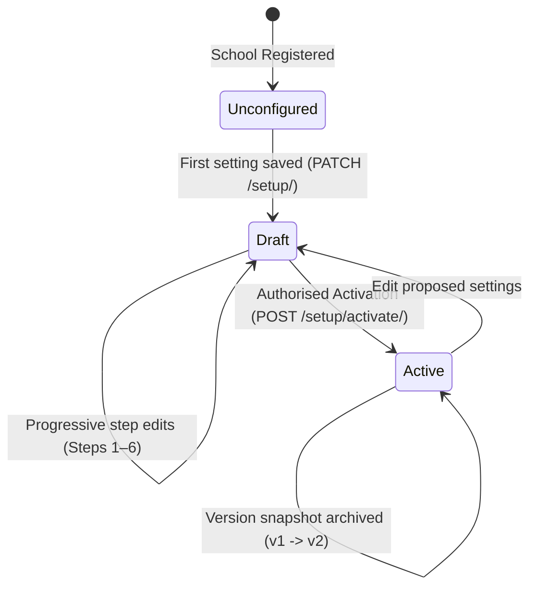

# OPTIMUS ORIEN — CROSS-MODULE FEATURE RELATIONSHIPS & DATA FLOW

**Specification Reference:** `OPTIMUS ORIEN.pdf` (Part 4: How Schools Are Organised & Data Connects)  
**System Architecture:** Multi-Tenant Relational Schema with Immutable Educational History  
**Document Version:** 1.0  
**Date:** October 2026  

---

## 1. Global Entity-Relationship Architecture

The Optimus Orien domain model enforces strict educational hierarchy and historical preservation. Every academic transaction (a mark entered, an attendance session taken, an intervention launched) connects through verifiable foreign keys back to an authenticated school and student.



---

## 2. Relational Hierarchy & Cardinality Rules

| Parent Entity | Child Entity | Cardinality | Deletion Rule | Cardinality Rule & Educational Justification |
| :--- | :--- | :--- | :--- | :--- |
| `Organisation` | `School` | 1 : N | `PROTECT` | A school cannot exist without a governing organisation. Deletion protected to prevent data orphanages. |
| `School` | `AcademicYear` | 1 : N | `PROTECT` | Academic years belong strictly to one school campus and cannot overlap conflicting dates. |
| `AcademicYear` | `SchoolClass` | 1 : N | `PROTECT` | A class section exists within an academic calendar period; historical classes remain when year closes. |
| `School` | `Subject` | 1 : N | `PROTECT` | Subject codes must be unique within a school to prevent duplicate markbooks. |
| `SchoolClass` | `Enrollment` | 1 : N | `PROTECT` | Students join a class through dated enrolments. When transferred, old enrolments are end-dated, never deleted. |
| `Student` | `Enrollment` | 1 : N | `CASCADE` | Student retains a complete chronological history of all class placements across their academic career. |
| `SchoolClass` | `Assessment` | 1 : N | `PROTECT` | Assessments are scheduled per class and subject. Past assessments cannot be deleted if grades exist. |
| `Assessment` | `Grade` | 1 : N | `PROTECT` | Every grade row links a student to an assessment with a validated score between 0 and `max_marks`. |
| `SchoolClass` | `Attendance` | 1 : N | `PROTECT` | Attendance sessions are recorded per class, date, and student. One status per student per session. |
| `Student` | `ReviewCase` | 1 : N | `PROTECT` | Support cases relate to a specific student and school, preserving historical interventions. |
| `ReviewCase` | `Intervention` | 1 : N | `CASCADE` | Concrete action steps belonging to an active or archived student review case. |

---

## 3. Core Lifecycle State Machines

### A. School Onboarding & Configuration Lifecycle
Governed by `core.services.school_setup` and `core.onboarding_views`:



- **Validation Gate:** Activation is strictly rejected until all 6 steps pass validation (valid country code, valid IANA time zone, non-overlapping reporting periods, approved grading & attendance policies).
- **Operational Side-Effect:** Upon activation, the school's authoritative `AcademicYear` is updated or created automatically, ensuring classes can immediately be provisioned.

### B. Student Enrolment & Transfer Lifecycle
Governed by `core.views.transfer_student` and `core.models.Enrollment`:

```mermaid
stateDiagram-v2
    [*] --> Admitted: Student Record Created
    Admitted --> Enrolled: Assigned to Class (Enrollment created, start_date=today)
    Enrolled --> Transferred: Transfer Initiated (POST /students/{id}/transfer/)
    Transferred --> Enrolled: Prior enrollment closed (end_date=today); New enrollment opened
    Enrolled --> Withdrawn: Student departs institution (end_date set, active=False)
```



- **Atomic Transfer Rule:** Transfers run inside a database transaction (`transaction.atomic()`). Prior class grades, historical attendance records, and previous enrollment spans are never altered or removed.

### C. Assessment & Grade Lifecycle
Governed by `core.models.Assessment`, `Grade`, and `core.services.access`:

```mermaid
stateDiagram-v2
    [*] --> DraftAssessment: Assessment scheduled by Teacher
    DraftAssessment --> MarksEntered: Teacher enters raw scores (0 <= mark <= max_marks)
    MarksEntered --> Published: Assessment published (published=True)
    Published --> Locked: Results visible to Student & Parent; marks locked against ad-hoc edits
```

- **Missing Marks Governance:** If a student does not have a grade record entered, the platform treats it as *unrecorded*, never as zero. It is excluded from class averages to avoid artificial grade distortion.

### D. Early Intervention Case Lifecycle
Governed by `core.models.ReviewCase` and `Intervention`:

```mermaid
stateDiagram-v2
    [*] --> Open: Triggered by Rule (Attendance < 80% or Grade < 60%) or Manual Referral
    Open --> UnderReview: Case assigned to designated Educator/Counselor
    UnderReview --> ActionPlan: Documented interventions scheduled with review dates
    ActionPlan --> Monitoring: Interventions in progress; attendance/grades tracked
    Monitoring --> Resolved: Measurable criteria met; outcomes documented
    Resolved --> Closed: Formally signed off by Principal or School Admin
```



---

## 4. Tenant Scoping & Permission Boundaries

Optimus Orien implements a strict **Deny-by-Default** security model enforced entirely server-side in `core.services.access`:

```
┌────────────────────────────────────────────────────────────────────────┐
│                        ORGANISATION BOUNDARY                           │
│  ┌──────────────────────────────────────────────────────────────────┐  │
│  │                          SCHOOL A                                │  │
│  │   Classes  •  Subjects  •  Staff  •  Students  •  Interventions  │  │
│  └──────────────────────────────────────────────────────────────────┘  │
│  ┌──────────────────────────────────────────────────────────────────┐  │
│  │                          SCHOOL B                                │  │
│  │   Classes  •  Subjects  •  Staff  •  Students  •  Interventions  │  │
│  └──────────────────────────────────────────────────────────────────┘  │
│  [Cross-School Data Flow: Blocked unless User is Organisation Admin]   │
└────────────────────────────────────────────────────────────────────────┘
 [Cross-Organisation Data Flow: 100% Forbidden across all user roles]
```

### Role Access Matrix:
1. **Organisation Admin:**
   - Scope: All schools within their assigned organisation.
   - Student Privacy Guard: Identifiable student records and CSV exports are hidden unless the organisation has set `allow_org_admin_student_access = True`.
2. **School Admin / Principal:**
   - Scope: Strictly limited to their single assigned school campus. Cannot access another school within the same organisation.
3. **Teacher:**
   - Scope: Limited to classes where they are the assigned class teacher or subject instructor.
   - Support Cases: Can only see `ReviewCase` records explicitly assigned to them.
4. **Student:**
   - Scope: Strictly their own user record, their own enrolled classes, their own published grades, and their own attendance marks.
5. **Parent / Guardian:**
   - Scope: Strictly students where their account is linked via `Student.guardians`. Cannot view any other students or class rosters.

---

## 5. Audit Logging & Immutability Rules

Every state modification creates an immutable entry in the `AuditEvent` log (`core.services.audit.record_event`):
- **Actor:** Authenticated user ID and username.
- **Action:** Structured action key (e.g. `school_setup_draft`, `school_setup_activated`, `student_transferred`).
- **Resource & ID:** Model class name and primary key.
- **Delta:** List of changed fields, before-values, and after-values.
- **Immutability:** `AuditEvent` records cannot be updated or deleted via any API endpoint (`HTTP 405 Method Not Allowed`).
