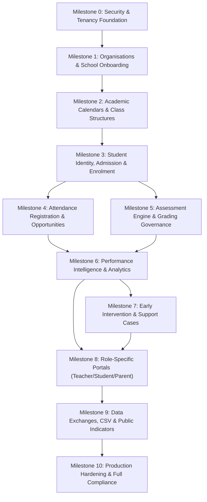

# OPTIMUS ORIEN — MASTER IMPLEMENTATION ROADMAP
**Specification Authority:** `OPTIMUS ORIEN.pdf` (Parts 1 through 21)  
**Document Version:** 1.0 (Post-Audit Baseline)  
**Creation Date:** October 2026  
**Architectural Baseline:** Multi-tenant Django 5 REST Framework + React 18 TypeScript / Vite  

---

## 1. System Architecture & Dependency Hierarchy

In an education management and school intelligence platform, operational entities cannot exist in isolation. Every higher-level educational metric (such as an academic average, attendance rate, or early warning flag) is strictly dependent on lower-level immutable records.



### Dependency Rules:
1. **No class without an Academic Year:** A `SchoolClass` must belong to an approved `AcademicYear`.
2. **No academic records without active Enrolment:** An `Assessment`, `Grade`, or `Attendance` record cannot be authored for a student unless an active `Enrollment` ties that student to the class during the relevant date window.
3. **No attendance calculation without calendar denominator:** Attendance percentage cannot divide by recorded rows alone; it must relate present sessions to eligible timetable opportunities excluding declared school closures.
4. **No intervention case without student provenance:** A `ReviewCase` belongs to a single authenticated student, scoped to their enrolled school, with immutable audit logging.

---

## 2. Milestone Breakdown & Phased Execution

### Milestone 0: Security Baseline & System Foundation
*Status: COMPLETE (Validated Live)*
- **Primary PDF Requirements:** `PR-010`, `SEC-001` through `SEC-015`, Part 0 Security Foundation.
- **Scope & Deliverables:**
  - Production Django + Vercel session authentication with CSRF cookie handshake (`/api/v1/auth/csrf/` -> `/api/v1/auth/login/`).
  - Production origin verification (`CSRF_TRUSTED_ORIGINS` & `CORS_ALLOWED_ORIGINS`).
  - Idempotent cloud administrator provisioning (`ensure_admin`) with secure environment-variable password synchronization.
  - Deny-by-default server-side authorization matrix (`core.services.access`).
  - Multi-tenant boundary isolation between separate educational organisations.
  - Elimination of hardcoded demo credentials and pre-fill buttons from public production login surfaces.
- **Verification Criteria:**
  - Authenticated session lifecycle test (login, authenticated request, logout, 403 rejection) passes live against Render backend and Vercel frontend.
  - Automated security regression suite (`test_security.py`) passes 100%.

---

### Milestone 1: Multi-Tenant Hierarchy, Organisations & School Configuration Setup
*Status: IN PROGRESS / BASELINE DELIVERABLE*
- **Primary PDF Requirements:** `PR-001`, `PR-004`, `PR-011`, `PR-012`, `EDUC-001`–`EDUC-015`, `ORG-001`–`ORG-005`, `SCH-001`–`SCH-006`.
- **Scope & Deliverables:**
  - Complete `Organisation` details view and management interface for `organisation_admin`.
  - School Setup 6-step guided wizard:
    1. Country, Time Zone, Language & Locale (`ISO 3166-1`, IANA time zones).
    2. Academic Year name and date boundary validation (`end_date > start_date`).
    3. Named Educational Programmes without arbitrary curriculum lock-in.
    4. Discrete, non-overlapping Reporting Periods.
    5. Grading approach, scale definition, and transparent calculation policy.
    6. Attendance tracking basis and status handling.
  - Configuration readiness validation (`core.services.school_setup.readiness`).
  - Draft vs. Active status governance with immutable version history snapshots (`SchoolConfigurationVersion`).
  - **Direct Operational Linkage:** Automated creation and activation of the authoritative `AcademicYear` record upon school configuration activation (`activate_school_configuration`).
- **Dependencies:** Milestone 0.
- **Verification Criteria:**
  - Draft configuration saving and field validation rejects incomplete payloads.
  - Activation locks draft, creates version snapshot, records audit event, and updates/creates the active `AcademicYear`.

---

### Milestone 2: Academic Structures & Teaching Assignments
*Status: SCHEDULED (Next Milestone)*
- **Primary PDF Requirements:** `ORG-006`–`ORG-014`, `CLS-001`–`CLS-008`, Part 3, Part 4.
- **Scope & Deliverables:**
  - Academic year and term/reporting period operational models.
  - Configurable Year Groups and Stages (freeform labels: Grade 1–12, Year 1–13, Form 1–6).
  - Subject registry per school with stable code and name constraints.
  - Class and section creation (`SchoolClass`) tied strictly to school and academic year.
  - Teacher assignments to classes (`teacher` role foreign key validation).
  - Subject teaching offerings and multiple subject teachers per class group.
- **Dependencies:** Milestone 1.
- **Verification Criteria:**
  - Class cannot be created in an academic year belonging to another school.
  - Non-teacher user cannot be assigned as class teacher.

---

### Milestone 2.5: Reports & Drill-Down Analytics (inserted 2026-10-22, precedes Milestone 3)
*Status: IMPLEMENTED — see `REPORTS_MILESTONE.md`*
- **Primary PDF Requirements:** Part 6 §11.3, §12, §16; Part 13.2; Part 15 §8.2, §8.3, §8.9, §9–10; `TDB-014`, `TDB-016`, `TDB-017`, `VIS-021`, `VIS-022`, `ORG-023`.
- **Scope & Deliverables:**
  - Organisation → Campus → Class → Subject drill-down endpoints with a persistent reporting period.
  - Student-level weighted averages; missing results reported, never zero; comparability flags.
  - Role scoping at every level; aggregates independent of the student-privacy flag, identifiable rows dependent on it.
- **Verification Criteria:** `backend/core/tests/test_reports.py` (21 tests) pass; frontend builds with zero TypeScript errors.

---

### Milestone 3: Student Identity, Admission, Enrolment & Transfers
*Status: SCHEDULED*
- **Primary PDF Requirements:** `PR-003`, `PR-009`, `ORG-015`–`ORG-018`, `STU-001`–`STU-014`, Part 7, Part 8.
- **Scope & Deliverables:**
  - Stable `Student` entity independent of temporary class assignment.
  - Admission number unique per school.
  - Historical dated `Enrollment` records (`start_date`, `end_date`, `status`).
  - Inter-class and inter-school atomic transfer workflow (`transfer_student` endpoint) preserving prior grades and attendance.
  - Guardian / Parent verified relationships (`Student.guardians`).
  - Opt-in organisation administrator policy for accessing identifiable student records (`allow_org_admin_student_access`).
- **Dependencies:** Milestone 2.
- **Verification Criteria:**
  - Transfer transaction rolls back cleanly on any validation error.
  - Past enrollment records remain immutable with historical end dates.

---

### Milestone 4: Daily Attendance & Calendar-Aligned Registers
*Status: SCHEDULED*
- **Primary PDF Requirements:** `PR-006`, `ATT-001`–`ATT-012`, Part 9, Part 10, Part 15.
- **Scope & Deliverables:**
  - Attendance registration interface for teachers by class and date.
  - Status tracking: Present, Late, Excused Absence, Unexcused Absence.
  - School calendar integration (instructional days vs holidays, closures, weekends).
  - Responsible denominator calculation: Attendance Rate = Present Sessions / (Recorded Eligible Sessions).
  - Missing register alert: Never treat an unrecorded register as an absence; surface explicitly as "Unrecorded Register".
  - Scoped parent and student attendance summaries.
- **Dependencies:** Milestone 3.
- **Verification Criteria:**
  - Duplicate attendance records for the same student on the same date/session are rejected.
  - Attendance percentage is never distorted by unrecorded future dates.

---

### Milestone 5: Assessment Engine, Grading Policies & Evaluation Governance
*Status: SCHEDULED*
- **Primary PDF Requirements:** `PR-005`, `PR-015`, `ASM-001`–`ASM-014`, `GRD-001`–`GRD-016`, Part 11, Part 12, Part 13, Part 15.
- **Scope & Deliverables:**
  - Discrete assessment setup: Subject, class, date, title, category (Exam, Quiz, Project, Assignment), maximum marks, weight.
  - Grade capture interface with real-time mark boundary validation (`0 <= raw_score <= max_marks`).
  - Grade publishing workflow (`published=True` required before student/parent visibility).
  - Published grade lock: Published grades cannot be modified without audit justification.
  - Responsible missing grade handling: Exclude unrecorded marks from class average; never default missing to zero.
  - Configurable grade boundary conversion (Letter grades, percentages, descriptive standards).
- **Dependencies:** Milestone 3.
- **Verification Criteria:**
  - Student and parent roles cannot view unrecorded or unpublished assessments.
  - Exceeding `max_marks` raises immediate HTTP 400 validation error.

---

### Milestone 6: Performance Intelligence, Aggregation & Explainable Analytics
*Status: SCHEDULED*
- **Primary PDF Requirements:** `PR-007`, `PR-015`, `IND-001`–`IND-012`, `REP-001`–`REP-014`, Part 6, Part 15, Part 16.
- **Scope & Deliverables:**
  - Transparent performance calculation engine (arithmetic mean, weighted average, sample sizes).
  - Data completeness badges: Every report displays sample count (`n=...`) and completeness notes.
  - School performance overview with multi-period comparison.
  - Subject mastery breakdowns across grade levels.
  - Longitudinal cohort performance tracking without fictitious trend lines.
  - Role-scoped export engine (CSV and print-ready report sheets).
- **Dependencies:** Milestones 4 and 5.
- **Verification Criteria:**
  - Averages accurately reflect database records with zero unexplained variance.
  - Small sample size disclaimer automatically rendered when student count < 10.

---

### Milestone 7: Early Intervention, Support Cases & Collaborative Action Plans
*Status: SCHEDULED*
- **Primary PDF Requirements:** `PR-008`, `CASE-001`–`CASE-016`, `INT-001`–`INT-010`, Part 16, Part 17, Part 18.
- **Scope & Deliverables:**
  - Automated early warning triggers based on approved school thresholds:
    - Attendance alert: `attendance_rate < school.attendance_alert_threshold` (e.g. < 80%).
    - Academic alert: `average_grade < school.grade_alert_threshold` (e.g. < 60%).
  - Case management lifecycle: `Open` -> `Under Review` -> `Action Plan` -> `Monitoring` -> `Resolved` -> `Closed`.
  - Intervention recording: Specific target, assigned owner, review date, outcome status.
  - Sensitive confidentiality controls: Teacher sees only assigned cases; student/parent see only supportive notes.
- **Dependencies:** Milestone 6.
- **Verification Criteria:**
  - Unauthorised teachers cannot list cases outside their assignments.
  - Case status changes create immutable audit entries with previous and updated states.

---

### Milestone 8: Role-Specific Portals & Accessible UI/UX
*Status: SCHEDULED*
- **Primary PDF Requirements:** `AUTH-001`–`AUTH-008`, `UI-001`–`UI-020`, Part 5, Part 17, Part 18, Part 20.
- **Scope & Deliverables:**
  - Distinct role views tailored to daily workflows:
    - **Organisation Admin:** Multi-school network view, school configuration activations, governance audits.
    - **School Admin / Principal:** Campus operations, teacher assignments, student rosters, school indicators.
    - **Teacher:** Daily attendance markbook, assessment entry, student support referrals.
    - **Student:** My classes, upcoming assignments, published results, attendance records.
    - **Parent:** Family dashboard, child academic progress, attendance alerts, teacher feedback.
  - WCAG 2.1 AA accessibility compliance (readable contrast, keyboard navigation, screen-reader aria labels).
  - Responsive mobile and tablet drawer navigation.
- **Dependencies:** Milestone 7.
- **Verification Criteria:**
  - Every screen displays zero buttons that do nothing.
  - Empty states, loading skeletons, and validation error messages are present on all forms.

---

### Milestone 9: Data Exchanges, CSV Import/Export & Public Indicators
*Status: SCHEDULED*
- **Primary PDF Requirements:** `PR-013`, `PUB-001`–`PUB-008`, `IMP-001`–`IMP-010`, Part 14, Part 21.
- **Scope & Deliverables:**
  - Validated CSV import pipeline for student rosters and historical records with dry-run preview.
  - Scoped CSV export for authorised administrators (`/api/v1/exports/students.csv`).
  - Public School Intelligence Indicator showcase (`/api/v1/public/indicators/`):
    - Display aggregate school performance for approved indicators.
    - Privacy protection: Minimum population threshold (`eligible_population >= 10`).
    - Explicit approval by system administrator required before publication.
    - Ban on public student-level data and competitive cross-school league tables.
- **Dependencies:** Milestone 8.
- **Verification Criteria:**
  - Public indicators endpoint never leaks identifiable student names, marks, or records.
  - Import wizard rolls back entire batch if any row fails validation.

---

### Milestone 10: Production Hardening, Compliance & Release
*Status: SCHEDULED*
- **Primary PDF Requirements:** Part 0, Part 21, Production Checklist.
- **Scope & Deliverables:**
  - End-to-end automated testing covering all 14 functional modules.
  - Database index optimisation for high-traffic querysets (`SchoolClass`, `Enrollment`, `Grade`, `Attendance`).
  - Production backup verification and restore dry-run script.
  - Final requirement traceability matrix sign-off.
- **Dependencies:** Milestones 0 through 9.
- **Verification Criteria:**
  - 100% passing test suite with zero regressions.
  - Zero high or critical security alerts in dependency trees.

---

## 3. Implementation Schedule & Progression Rule

```
[Milestone 0: Security Baseline] ──> COMPLETE (Oct 2026)
        │
[Milestone 1: Org & Setup Linkage] ─> IN PROGRESS (Active Turn)
        │
        ▼ (STOP for user review & consent)
[Milestone 2: Academic & Classes] ──> Next
        │
[Milestones 3–10] ───────────────────> Following Sprints
```

> [!IMPORTANT]
> Development proceeds strictly milestone-by-milestone. In accordance with the development protocol, Milestone 1 will be fully verified, tested, and documented before any code for Milestone 2 is committed.
