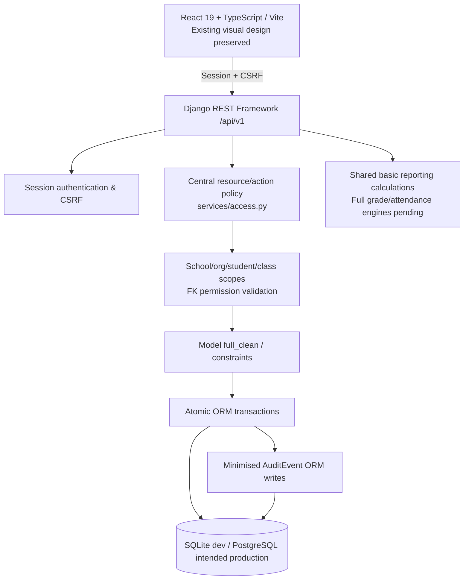

# Phase 1 architecture and trust boundaries

## Repository

- `frontend/src/`: preserved React/TypeScript app and styling.
- `backend/config.py`: Django settings, environment configuration and security defaults.
- `backend/core/models.py`: schema and core data integrity rules.
- `backend/core/services/access.py`: role/action matrix, relation authorization, queryset scoping.
- `backend/core/services/audit.py`: privacy-conscious audit events.
- `backend/core/views.py`: API serialization and controllers, atomic persistence + transfer endpoint.
- `backend/core/migrations/0001_initial.py`: initial schema migration.
- `backend/core/tests/`: API security and integrity tests.
- `docs/`: architecture, security policy, requirements traceability and delivery status.

## Next architecture steps

Split `core` into separate domain apps once migrations/data upgrade can be safely coordinated. This release deliberately centralises security without destabilising all existing models and frontend contracts. Production tasks include queue workers, mail integrations, database backups, distributed rate-limits and privacy-retention features; these are **not implemented**.
